# Day 0 — Electronics Prerequisites

> **Welcome to Day 0!** This essential electronics foundation guide comes **before** ESP32 Firmware Day 1. **Read this once, slowly, before you power up an ESP32, Arduino, or any sensor.** It assumes you know *nothing* about electronics. Nothing is skipped. Every idea is explained with everyday things you already understand — mostly water, pipes, and visual diagrams.

> **How to read this guide**
> Don't memorise formulas. Just understand the *idea* behind each one. Every section ends with **"In one sentence"** — if you understand that line, you understand the topic.

---

## 📚 What's Inside

```
PART A – What electricity actually is
PART B – The three big ideas: Voltage, Current, Resistance
PART C – Ohm's Law (the one formula you'll use forever)
PART D – Power and heat (why things get warm and burn)
PART E – Series and Parallel circuits
PART F – Digital vs Analog signals
PART G – The ADC (how a chip "reads" the real world)
PART H – Logic levels: 3.3 V vs 5 V (how NOT to kill your board)
PART I – Floating pins & pull-up/pull-down resistors
PART J – Voltage dividers (measuring 12 V safely)
PART K – LEDs and current-limiting resistors
PART L – Capacitors (fixing random crashes)
PART M – Buttons and "bounce"
PART N – Transistors & MOSFETs (giving your board muscles)
PART O – Diodes & flyback protection
PART P – Ground (GND) and the Common Ground rule
PART Q – Reading a schematic
PART R – Breadboard basics
PART S – Using a multimeter
PART T – SENSOR PROTOCOLS (how sensors actually talk to your board)  ← most important for sensors
PART U – Your first three mini-projects
PART V – Final checklist + mini glossary
```

---

# PART A — What Electricity Actually Is

### A1. Everything is made of atoms

Everything around you — a wire, a glass of water, your hand — is made of tiny **atoms**.

Each atom has a centre and tiny particles flying around it. The important ones are **electrons** (they carry a negative charge, written as **−**).

<p align="center">
  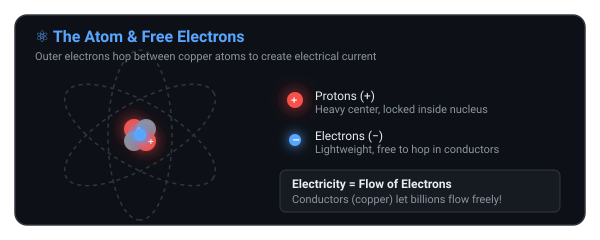
</p>

### A2. Some materials let electrons move, some don't

| Type | Examples | Behaviour |
|---|---|---|
| **Conductor** | Copper, silver, gold, aluminium | Electrons move easily |
| **Insulator** | Plastic, rubber, glass, ceramic | Electrons are stuck |

That's why wires are **copper on the inside** (electrons flow) and **plastic on the outside** (electrons don't jump into your hand).

> **In one sentence: Electricity is just electrons moving through a wire.**

---

### A3. Electrons only move in a complete loop (a "circuit")

Electrons will not leave a battery and vanish. They only move if there is a **complete, unbroken path** from the power source, through your device, and back again.

<p align="center">
  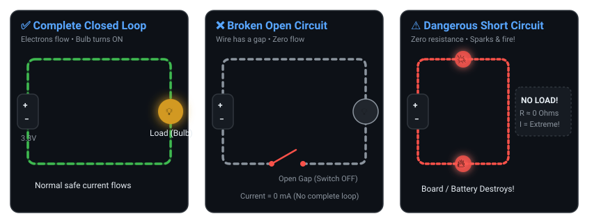
</p>

- Any gap = **open circuit** = nothing works.
- A light switch is nothing more than a mechanical gap-maker. OFF = gap. ON = no gap.

### A4. A "short circuit" (the dangerous path)

If you connect **+** straight to **−** with only a wire and nothing in between, electrons rush through all at once. The wire gets white-hot. Battery swells. Sparks. **Your board dies.**

This is called a **short circuit**. Almost every component in electronics exists to *prevent* this from happening to something expensive.

> **In one sentence: Electricity only flows in a complete loop — and if that loop has nothing to slow it down, it burns.**

---

# PART B — The Three Big Ideas

Every circuit in the world, from a phone to a satellite, is described by just three things:

| Idea | Symbol | Unit | Water analogy |
|---|---|---|---|
| **Voltage** | V | volt (V) | Water **pressure** in the pipe |
| **Current** | I | ampere (A, mA) | **Amount** of water flowing per second |
| **Resistance** | R | ohm (Ω) | A **narrow** section of pipe |

### The Water Tank Analogy Visualized

<p align="center">
  
</p>

---

### B1. Voltage (V) — the push

- **What it is:** the electrical pressure that pushes electrons.
- **Water version:** the height of the tank. A tank on the roof pushes harder than a bucket on the floor.
- **Real values you'll meet:**

| Source | Voltage |
|---|---|
| AA battery | 1.5 V |
| **ESP32 board** | **3.3 V** ← the modern standard |
| Old Arduino Uno | 5.0 V |
| USB port | 5.0 V |
| Car battery | 12 V |
| Wall socket | 120 V – 230 V ⚠️ (deadly) |

---

### B2. Current (I) — the flow

- **What it is:** how many electrons pass a point every second.
- **Water version:** litres per minute.
- Small numbers are written in **milliamps (mA)**.

```
1 A = 1000 mA        1 mA = 0.001 A
```

**Real values on an ESP32:**

| Situation | Current |
|---|---|
| One small LED (recommended beginner experiment) | 5 – 10 mA (bright, safe, and cool) |
| ESP32 doing nothing | 30 – 50 mA |
| ESP32 sending Wi-Fi | up to **240 mA** (a big sudden burst!) |
| ESP32 in deep sleep | 0.01 mA |
| Safe continuous GPIO operating current | ~12 – 20 mA (nominal design limit) |
| Absolute maximum GPIO silicon limit | ~40 mA (⚠️ Never design for this limit!) |

> ⚠️ That GPIO row matters. **A GPIO pin is a weak, tiny signal output. It is not a power source.** Never design circuits targeting the 40 mA absolute maximum limit; keep normal LED loads between 5 mA and 10 mA.

---

### B3. Resistance (R) — the squeeze

- **What it is:** opposition to the flow of electrons.
- **Water version:** a narrow pipe, a kink in the hose, a half-closed tap.
- A thick copper wire ≈ 0 Ω (nothing). A rubber block ≈ millions of Ω (nothing passes).
- A **resistor** is a component built to have an exact, known resistance — so you can control current on purpose.
- **Schematic symbol:** Drawn on schematics as a zigzag line (US convention) or a simple rectangle (IEC standard).

> **In one sentence: Voltage pushes, current flows, resistance holds back.**

---

# PART C — Ohm's Law

This one formula connects all three. Everything else in this guide uses it:

$$\mathbf{V = I \times R} \qquad (\text{Voltage} = \text{Current} \times \text{Resistance})$$

### The Triangle Trick

<p align="center">
  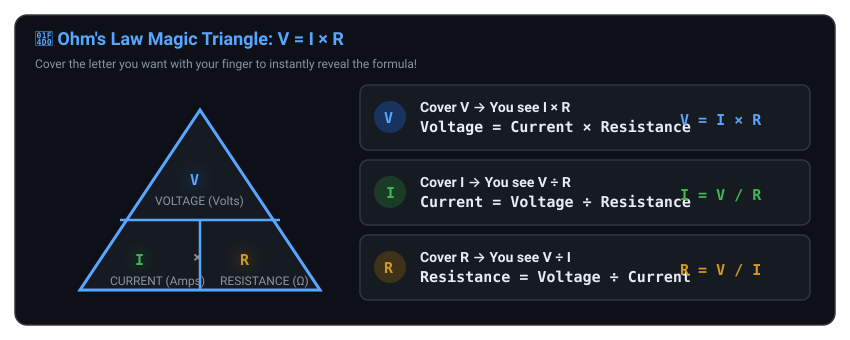
</p>

Now **cover the letter you want** with your finger — the two remaining letters tell you what to do:

| You want | Cover | You get | Meaning |
|---|---|---|---|
| Voltage | V | I × R | Voltage = Current × Resistance |
| Current | I | V ÷ R | Current = Voltage ÷ Resistance |
| Resistance | R | V ÷ I | Resistance = Voltage ÷ Current |

### Two Everyday Examples

**Example 1 — How much current flows through a 1 kΩ resistor on 3.3 V?**

```
I = V ÷ R = 3.3 ÷ 1000 = 0.0033 A = 3.3 mA
```
Small and safe. The pin is happy.

**Example 2 — Why must an LED always have a current-limiting resistor?**

An LED is a **non-linear semiconductor device**, not a fixed resistor. Below its forward turn-on threshold (about 2.0 V for a red LED), it draws almost no current. But once that voltage is reached, the LED turns on and current increases exponentially. Connected directly without a resistor, current quickly exceeds what the LED and pin can handle, destroying both!

The current is controlled by the external resistor using the formula:

$$R = \frac{V_{\text{supply}} - V_{\text{LED\_forward}}}{I_{\text{desired}}}$$

Or in plain text:
```
R = (Supply Voltage − LED Forward Voltage) / Desired LED Current
```

For an ESP32 ($3.3\text{ V}$) driving a red LED ($2.0\text{ V}$) at a safe beginner current of $6\text{ mA}$ ($0.006\text{ A}$):
```
R = (3.3 V − 2.0 V) / 0.006 A
R = 1.3 V / 0.006 A ≈ 217 Ω  -->  use 220 Ω
```

We recommend approximately **5–10 mA** for beginner LED experiments. A standard **220 Ω** resistor is ideal.

### What this tells you about the world

- Push harder (**higher V**) → more flow (**higher I**).
- Squeeze harder (**higher R**) → less flow (**lower I**).
- Squeeze to zero (**R = 0**) → current becomes huge → short circuit.

> **In one sentence: If you know any two of V, I, R, you always know the third.**

---

# PART D — Power and Heat

When electrons are forced through resistance, there is friction. Friction makes **heat**.

The rate of energy being used is called **power (P)**, measured in **watts (W)**:

$$\mathbf{P = V \times I}$$

### Why this matters: resistors have a heat limit

Resistors are sold with two numbers: their **resistance** (ohms) and their **power limit** (watts).

| Resistor size | Power it can handle |
|---|---|
| Tiny SMD chip resistor | 0.125 W (1/8 W) |
| Standard hobby resistor | **0.25 W** (1/4 W) |
| Big "power" resistor | 0.5 W or more |

**Example:** put 12 V across a small 100 Ω resistor.

```
Current:  I = 12 ÷ 100 = 0.12 A
Power:    P = 12 × 0.12 = 1.44 W
```

You're dumping 1.44 W into a part rated for 0.25 W. It will smoke and go black in about 5 seconds.

> 💡 In small 3.3 V circuits, a normal 1/4 W resistor almost never gets hot. But when you work with 12 V or 24 V, **always check the wattage**.

> **In one sentence: Power is voltage times current — and resistors have a maximum power they can survive.**

---

# PART E — Series and Parallel Circuits

There are only two ways to connect things. Learn these two rules and you understand every circuit diagram.

<p align="center">
  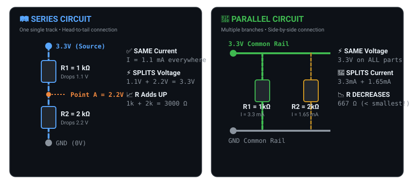
</p>

> [!IMPORTANT]
> **Series Rules (Single Track):**
> - Current ($I$) is the **same** through all components.
> - Voltage ($V$) **splits** across components ($V_{\text{total}} = V_1 + V_2 + \dots$).
> - Resistances **add up** ($R_{\text{total}} = R_1 + R_2 + \dots$).
>
> **Parallel Rules (Branching Paths):**
> - Voltage ($V$) is the **same** across all branches.
> - Current ($I$) **splits** across branches ($I_{\text{total}} = I_1 + I_2 + \dots$).
> - Total resistance **decreases** (always smaller than the smallest branch resistor).

### Series, with real numbers

Consider a 3.3 V supply feeding $R_1 = 1\text{ k}\Omega$ in series with $R_2 = 2\text{ k}\Omega$ down to Ground (as shown in the Series diagram above):

1. **Total resistance:** 1000 + 2000 = **3000 Ω**
2. **Total current:** 3.3 ÷ 3000 = 0.0011 A = **1.1 mA** (the *same* current flows through both resistors)
3. **Voltage across R1:** 0.0011 × 1000 = **1.1 V**
4. **Voltage across R2:** 0.0011 × 2000 = **2.2 V**
5. **Check:** 1.1 + 2.2 = 3.3 V ✅

**Voltage at Point A = 3.3 − 1.1 = 2.2 V.**

That little calculation is called a **voltage divider** — and you will use it constantly.

### Parallel, with real numbers

Consider a 3.3 V supply connected across three parallel branches of 1 kΩ, 2 kΩ, and 3 kΩ to GND (as shown in the Parallel diagram above):

1. **Voltage across each:** 3.3 V (all the same — they all touch the same two rails)
2. **Currents:** 3.3 mA, 1.65 mA, 1.10 mA
3. **Total current:** 3.3 + 1.65 + 1.10 = **6.05 mA**
4. **Total resistance:** **545 Ω** — *less than the smallest resistor (1000 Ω)*

> 🌟 **Why does parallel resistance get smaller?**
> Think of highway lanes. Adding another lane (even a slow one) lets more cars through at once. More paths = less overall resistance.

**Shortcut for exactly two parallel resistors:**
```
R = (R1 × R2) ÷ (R1 + R2)

Two 10 kΩ in parallel → (10 × 10) ÷ (10 + 10) = 5 kΩ
```
**Rule: two identical resistors in parallel halve the resistance.**

### Side by Side

| | **Series** | **Parallel** |
|---|---|---|
| Current | Same everywhere | Splits |
| Voltage | Splits | Same everywhere |
| Total R | Adds up | Gets smaller |
| If one part breaks | Whole circuit dies | Other branches keep working |
| Everyday example | Old Christmas lights | Wall sockets in a house |
| ESP32 example | LED + resistor | Several sensors on the 3V3 rail |

> **In one sentence: Series = one path (voltage splits); Parallel = many paths (current splits).**

---

# PART F — Digital vs Analog Signals

A microcontroller is a digital machine. The real world is analog. Bridging those two is half of embedded engineering.

<p align="center">
  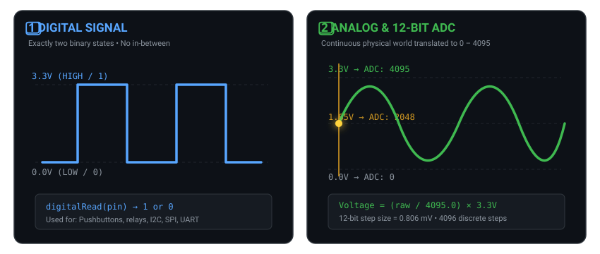
</p>

### Digital signals — only 0 or 1

- **HIGH** = full voltage (3.3 V) = `1` = `true`
- **LOW** = zero voltage (0 V) = `0` = `false`
- Nothing in between. Ever.
- **Used for:** buttons (pressed / not pressed), turning a relay on/off, chip-to-chip data.

### Analog signals — any value

- Anything from 0.00 V to 3.30 V: 0.34 V, 1.15 V, 2.89 V…
- **Used for:** knobs, temperature sensors, light sensors, battery voltage.
- ✋ But a chip only understands 0s and 1s. So how does it read 1.72 V? → **The ADC** (next part).

> **In one sentence: Digital is on/off; analog is a smooth slide — and the ADC is the translator.**

---

# PART G — The ADC (Analog-to-Digital Converter)

### G1. What it does

The ADC takes a voltage on a pin (0 – 3.3 V) and turns it into a whole number your code can read.

For the ESP32 (which has a **12-bit** ADC):

| Voltage at the pin | Number your code gets |
|---|---|
| 0.0 V | 0 |
| 1.65 V (halfway) | 2048 |
| 3.3 V | **4095** |

### G2. Why 4095 and not 4096?

A **bit** is a single switch: 0 or 1.

| Bits | Possible values | Highest value |
|---|---|---|
| 1 bit | 0, 1 | 1 |
| 2 bits | 00, 01, 10, 11 | 3 |
| 3 bits | 000 … 111 | 7 |
| **12 bits** | all combinations | **4095** |

The rule is always:
```
Highest number = (2 ^ number_of_bits) − 1

12 bits → 2^12 = 4096 → 4096 − 1 = 4095
```

**Why minus 1?** Because computers start counting at **0**. With 12 bits you have 4096 *steps*, numbered 0 to 4095 — the same way a 4 cm ruler has 5 marks but only 4 gaps.

### G3. The universal ADC formula

This works on **every** chip, at **every** bit setting:

$$V_{\text{measured}} = \left(\frac{\text{raw reading}}{\text{max reading}}\right) \times V_{\text{reference}}$$

**For the ESP32 (default 12-bit):**

$$V = \left(\frac{\text{raw}}{4095.0}\right) \times 3.3\text{ V}$$

Reverse it, if you know the voltage and want the raw number:

$$\text{raw} = \left(\frac{\text{voltage}}{V_{\text{reference}}}\right) \times \text{max reading}$$

**For the ESP32 (default 12-bit):**

$$\text{raw} = \left(\frac{\text{voltage}}{3.3\text{ V}}\right) \times 4095$$

```text
                     raw reading
V_measured = ─────────────────────────── × V_reference
                     max reading

For ESP32 (12-bit default):
              raw
Voltage = ────────── × 3.3 V
            4095.0
```

| Term | Meaning |
|---|---|
| `raw` | the integer number your code reads (0 – 4095 on 12-bit) |
| `max reading` | $2^n - 1$ → 511 (9-bit), 1023 (10-bit), 2047 (11-bit), or 4095 (12-bit) |
| $V_{\text{reference}}$ | the full-scale reference voltage → 3.3 V on ESP32 (with 11dB attenuation) |

### G4. What happens if you change the bit width?

The ESP32 actually lets you change the resolution in software. Under the hood, it just uses fewer bits of the same register:

```cpp
// 12-bit (DEFAULT) — uses all 12 bits of the register
analogReadResolution(12);
int val = analogRead(34);  // 0 to 4095
// Register: [b11 b10 b9 b8 b7 b6 b5 b4 b3 b2 b1 b0]
//            1    1   1  1  1  1  1  1  1  1  1  1  = 4095

// 10-bit — uses only 10 bits (top 2 bits ignored)
analogReadResolution(10);
int val = analogRead(34);  // 0 to 1023
// Register: [ x   x  b9 b8 b7 b6 b5 b4 b3 b2 b1 b0]
//                        1  1  1  1  1  1  1  1  1  1 = 1023

// 9-bit — uses only 9 bits
analogReadResolution(9);
int val = analogRead(34);  // 0 to 511
// Register: [ x   x   x  b8 b7 b6 b5 b4 b3 b2 b1 b0]
//                           1  1  1  1  1  1  1  1  1 = 511
```

```text
┌──────────┬───────────┬──────────┬───────────────────────────┐
│ Setting  │ Bits Used │ Max Value│ Register View             │
├──────────┼───────────┼──────────┼───────────────────────────┤
│ 12-bit   │ 12        │ 4095     │ [1111 1111 1111]         │
│ 11-bit   │ 11        │ 2047     │ [x111 1111 1111]         │
│ 10-bit   │ 10        │ 1023     │ [xx11 1111 1111]         │
│  9-bit   │  9        │  511     │ [xxx1 1111 1111]         │
└──────────┴───────────┴──────────┴───────────────────────────┘

x = unused bits (always 0)
```

| Setting | Bits | Max number | Smallest voltage step it can see |
|---|---|---|---|
| **12-bit** (default) | 12 | **4095** | 3.3 ÷ 4095 = **0.806 mV** |
| 11-bit | 11 | 2047 | 1.612 mV |
| 10-bit | 10 | 1023 | 3.226 mV |
| 9-bit | 9 | 511 | 6.458 mV |

Higher bits = finer detail. Use 12-bit unless you need raw speed.

```cpp
analogReadResolution(12);           // 0 … 4095
analogSetAttenuation(ADC_11db);     // allow the full 0 – 3.3 V range

int raw = analogRead(34);
float voltage = (raw / 4095.0) * 3.3;   // the universal formula, in code
```

> ⚠️ **ESP32 pin note:** only **ADC1** pins work reliably while Wi-Fi is on — that's **GPIO 32, 33, 34, 35, 36, 39**. Pins 34–39 are **input only** (no output, no pull-ups).

> **In one sentence: The ADC turns a voltage into a number — and that number divided by 4095 times 3.3 gives you the voltage back.**

---

# PART H — Logic Levels: 3.3 V vs 5 V

### The Golden Rule

> ⚠️ **THE ESP32 RUNS ON 3.3 V. ITS PINS ARE NOT 5 V TOLERANT.**

- Old microcontrollers: **5 V** logic.
- ESP32, ESP32-S3, STM32, Raspberry Pi Pico: **3.3 V** logic.

<p align="center">
  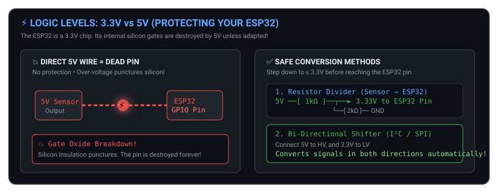
</p>

### Why 5 V kills it

Inside the chip, transistors are microscopic — the insulating layers are only a few atoms thick. At 3.3 V they hold. At 5 V the pressure punches a permanent microscopic hole. That pin is dead **forever**. There is no error message — just failure.

### Two Safe Ways to Connect a 5 V Sensor

**Way 1 — Resistor divider (sensor → ESP32 only, one direction):**
Use a 1 kΩ and 2 kΩ resistor divider:
$$\mathbf{V_{\text{pin}} = 5\text{ V} \times \left(\frac{2\text{ k}\Omega}{1\text{ k}\Omega + 2\text{ k}\Omega}\right) = 3.33\text{ V}} \qquad \text{✅ Safe for the ESP32}$$

**Way 2 — Logic level shifter module (both directions, e.g. I²C):**
A tiny cheap module (built around BSS138 MOSFETs). Connect 5 V to `HV`, 3.3 V to `LV`, and it converts both ways automatically.

> 💡 **Beginner tip:** when buying sensors, look for **"3.3 V compatible"**. It saves you all of this.

> **In one sentence: Feed 5 V into a 3.3 V pin and that pin is gone forever — convert the voltage first.**

---

# PART I — Floating Pins, Pull-Ups and Pull-Downs

This is the **number-one beginner bug** in all of embedded work.

<p align="center">
  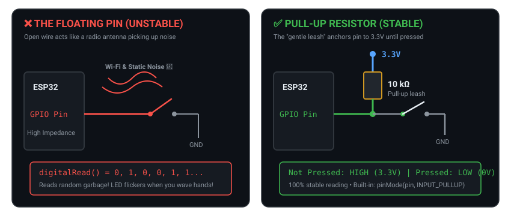
</p>

### The Bug

```
   Button pressed  → LED on.  ✅
   Button released → LED flickers randomly!
   Wave your hand near the board → it changes again!
```

Your code is fine. **Your pin is floating.**

### Why it happens

When the button is not pressed, the pin is connected to *nothing* — just a piece of wire hanging in the air. An open pin has near-infinite resistance, behaving like a **radio antenna** that picks up Wi-Fi radio waves, static electricity, and electromagnetic hum. The chip reads that noise as random rapid presses.

### The Fix: A "Leash" Resistor

**Pull-up (the most common setup):**
Connect a 10 kΩ resistor between **3.3 V and the GPIO pin**, while the push button connects from the **GPIO pin to GND**:

- Button **not** pressed → the 10 kΩ gently holds the pin at **3.3 V (HIGH)**.
- Button **pressed** → the pin is pulled firmly to **0 V (LOW)**.

> **Why a resistor and not a plain wire?** A plain wire from 3.3 V to the button would create a short circuit to ground the moment you pressed it.

**Pull-down** is the mirror image: the resistor holds the pin at **0 V (LOW)** by default, and pressing the button makes it **HIGH**.

### The ESP32 has them built in

```cpp
pinMode(BUTTON_PIN, INPUT_PULLUP);   // internal ~45 kΩ pull-up, no external resistor needed
```

Now:
```
not pressed → HIGH
pressed     → LOW      (this is called "active-low")
```

> ⚠️ **Important:** GPIO **34, 35, 36, 39** are input-only and have **NO internal pull-ups**. If you use them, you must add a real resistor.

> **In one sentence: An unconnected pin picks up noise — a pull-up or pull-down resistor gives it a fixed, known value.**

---

# PART J — Voltage Dividers (Measuring High Voltages Safely)

### The Problem

You want to monitor a **12 V car battery** with an ESP32. But the ADC pin dies above 3.3 V.

### The Solution

Two resistors in series scale the voltage down **proportionally**.

<p align="center">
  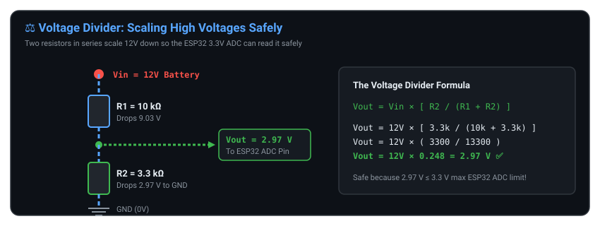
</p>

**The Formula:**

$$\mathbf{V_{\text{out}} = V_{\text{in}} \times \left(\frac{R_2}{R_1 + R_2}\right)}$$

**With our numbers:**

```
V_out = 12 × ( 3300 ÷ (10000 + 3300) )
      = 12 × ( 3300 ÷ 13300 )
      = 12 × 0.248
      = 2.97 V     ✅ safe for the ESP32
```

### Turning the reading back into the real voltage, in code

$$\mathbf{V_{\text{battery}} = V_{\text{measured}} \times \left(\frac{R_1 + R_2}{R_2}\right)}$$

> **In one sentence: Two resistors in series shrink a big voltage down to a safe one you can measure.**

---

# PART K — LEDs and Current-Limiting Resistors

### What an LED is

**LED = Light Emitting Diode.** An LED is a **non-linear semiconductor device**, not a standard linear resistor. Below its forward voltage threshold ($V_f$), it draws almost no current. But as soon as voltage reaches $V_f$, the diode begins conducting, and its dynamic resistance drops drastically. Connected directly across power and ground without a resistor, current surges out of control — resulting in burned silicon and a destroyed microcontroller pin.

**The external resistor controls and limits the LED current.**

<p align="center">
  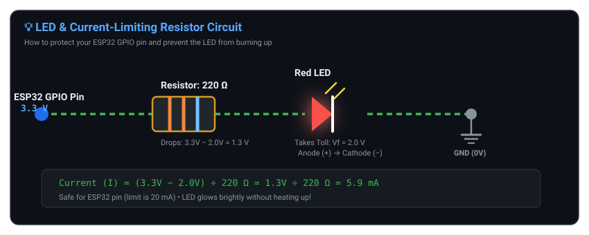
</p>

### Forward Voltage (V_f) — the "Toll Booth"

Every LED steals a fixed amount of forward voltage just to switch on:

| LED colour | Typical Forward Voltage ($V_f$) |
|---|---|
| Red / amber | ≈ 2.0 V |
| Yellow / green | ≈ 2.2 V |
| Blue / white | ≈ 3.0 V |

### Calculating the Resistor, Step by Step

The fundamental equation for sizing an LED current-limiting resistor is:

```
R = (Supply Voltage − LED Forward Voltage) / Desired LED Current
```

$$R = \frac{V_{\text{supply}} - V_f}{I_{\text{desired}}}$$

**Recommended Design Current**:
For beginner LED experiments, target approximately **5–10 mA** ($0.005\text{ A} \dots 0.010\text{ A}$). At 6 mA, a modern LED is brightly lit, generates no noticeable heat, and draws safely from the pin without coming anywhere near the chip's absolute maximum ratings. (Never treat an absolute maximum silicon limit like 40 mA as a design target!)

**Worked Example with an ESP32 (3.3 V) and a Red LED (2.0 V) at 6 mA (0.006 A)**:

**Step 1 — Calculate voltage across the resistor**:
```
V_resistor = Supply Voltage − LED Forward Voltage
V_resistor = 3.3 V − 2.0 V = 1.3 V
```

**Step 2 — Apply Ohm's law with desired current (6 mA = 0.006 A)**:
```
R = (3.3 V − 2.0 V) / 0.006 A
R = 1.3 V / 0.006 A ≈ 217 Ω
```

**Step 3 — Pick the nearest standard resistor value**:
```
217 Ω ≈ 220 Ω  (Standard 220 Ω resistor in every starter kit)
With 220 Ω:  I = 1.3 V ÷ 220 Ω ≈ 5.9 mA    → bright, cool, and safe! ✅
```

> 💡 **Rule of thumb for beginners: A 220 Ω (or 330 Ω) resistor is the ideal partner for standard LEDs on a 3.3 V ESP32.**

### Which leg is which?

- **Anode (+)** → the **longer** leg → goes toward the positive / resistor side.
- **Cathode (−)** → the **shorter** leg (or the flat edge on the plastic) → goes to **GND**.

> **In one sentence: An LED without a resistor is a short circuit — always put a 220–330 Ω resistor in front of it.**

---

# PART L — Capacitors (Stopping Random Crashes)

### What a capacitor is

A **tiny rechargeable battery** that charges in microseconds and can dump all its energy instantly. It acts like a **shock absorber** for voltage.

<p align="center">
  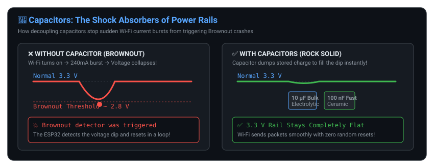
</p>

### The Famous "Brownout" Problem

When your code calls `WiFi.begin()`, the radio demands a sudden **240 mA burst**. If your USB cable is long or your breadboard wires are thin, the 3.3 V rail sags to 2.8 V. The ESP32 detects the dip and **resets itself**, printing:

```
Brownout detector was triggered
```

### The Fix

Put two capacitors right next to the ESP32, across the power rails:

| Capacitor | What it does |
|---|---|
| **10 µF – 100 µF electrolytic** | Big reservoir for the Wi-Fi bursts |
| **0.1 µF (100 nF) ceramic** | Fast filter that eats high-frequency noise |

> 🌟 If your ESP32 reboots every time Wi-Fi starts, **94% of the time it's a missing capacitor**, not your code.

> **In one sentence: A capacitor holds spare charge so sudden current bursts don't crash your board.**

---

# PART M — Buttons and "Bounce"

### What your finger feels vs. what the chip sees

To you, a button press is one clean click. To an ESP32 running **240 million cycles per second**, it's a violent mechanical event: the metal contacts bounce against each other 30–50 times over 10 to 20 milliseconds.

<p align="center">
  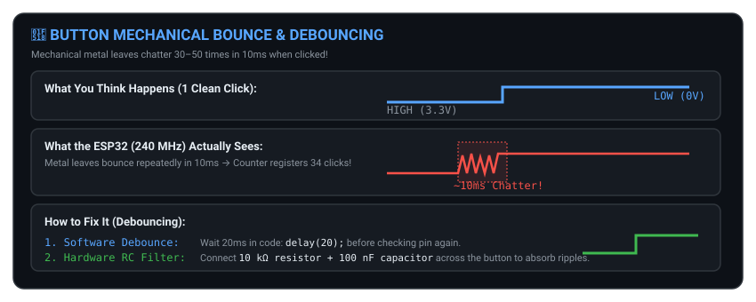
</p>

Without debounce protection, pressing the button once makes your software register dozens of phantom button clicks!

### Fix 1 — Software debounce (free)

```cpp
if (digitalRead(BUTTON_PIN) == LOW) {
    delay(20);                                  // wait for the bounce to settle
    if (digitalRead(BUTTON_PIN) == LOW) {        // still pressed? it's real
        count++;
        while (digitalRead(BUTTON_PIN) == LOW); // wait until released
    }
}
```

### Fix 2 — Hardware debounce

A **10 kΩ resistor + 100 nF capacitor** across the button smooths the ripples out before they ever reach the pin.

> **In one sentence: A physical button "chatters" — either wait 20 ms in code or add an RC filter.**

---

# PART N — Transistors and MOSFETs (Muscles)

### The Problem

A GPIO pin can safely give **about 20 mA at 3.3 V**. What if you want to switch on:

- a 500 mA relay?
- a 2 A motor?
- a 5 A LED strip?

Connect any of those directly and the pin **vaporises**.

### The Solution: An Electronic Switch

A transistor is an electrically controlled switch or valve. A **tiny 3.3 V signal** (drawing less than 5 mA) from the ESP32 controls a **huge 12 V flow of power** from a separate power supply.

<p align="center">
  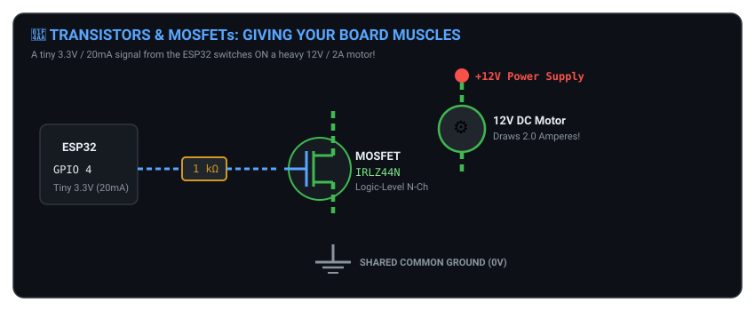
</p>

- GPIO **LOW (0 V)** → switch OFF → motor stops.
- GPIO **HIGH (3.3 V)** → switch ON → 12 V flows through the motor.

### Which one to pick

| Component | Good for | Examples |
|---|---|---|
| **NPN transistor** | Small loads up to ~500 mA | Buzzers, small relays (2N2222, BC547) |
| **Logic-level N-channel MOSFET** | Big loads, 5 A – 30 A, almost no heat | Motors, LED strips (IRLZ44N, AO3400) |

> ⚠️ Always buy **"logic-level"** MOSFETs. Ordinary MOSFETs need 10 V to switch on and will only get half-on at 3.3 V — and then they overheat.

> **In one sentence: A pin can't power a motor — a transistor lets the pin *control* the motor instead.**

---

# PART O — Diodes and Flyback Protection

### What a diode is

A **one-way valve**. Current flows freely from the anode (+) to the cathode (−), but is completely blocked in the reverse direction.

<p align="center">
  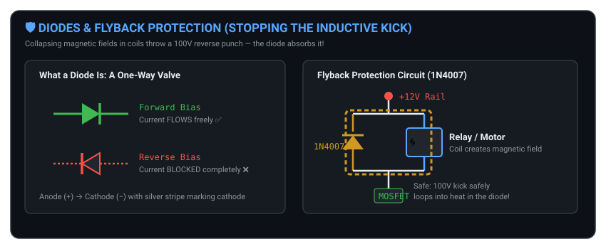
</p>

### The danger: inductive kickback

Motors, relays and solenoids contain **coils of wire** (inductors). When electricity flows, they store magnetic energy. When you suddenly switch the power off, that magnetic field collapses — generating a **huge reverse voltage spike of 50 V to 200 V**. That spike races backwards and punches straight through your switching transistor.

### The fix: a flyback diode

Place a diode (such as a standard **1N4007**) in reverse across the coil terminals:

- **Running normally:** The diode is reverse-biased (blocks current) and does nothing.
- **Switching off:** The collapsing magnetic energy loops harmlessly through the diode and dissipates as heat, protecting the transistor.

> 💡 It costs about 2 cents and saves your entire project. **Always add a flyback diode for any inductive load (motors, relays, solenoids).**

> **In one sentence: Coils throw a high-voltage punch when switched off — a reversed diode absorbs it.**

---

# PART P — Ground (GND) and the Common Ground Rule

### What ground really is

Ground is **not** a magical drain that eats electricity. Voltage is always a **difference between two points**. Ground is simply the **zero reference** we measure everything else against.

- "This pin is at 3.3 V" actually means *"this pin is 3.3 V above our ground reference."*

### ⚠️ The most common wiring mistake of all time

<p align="center">
  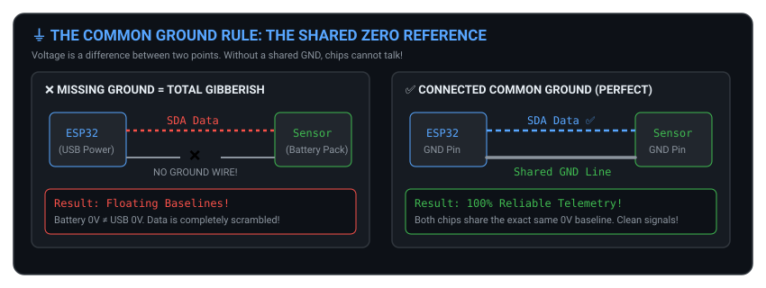
</p>

If you power an ESP32 via USB and connect a sensor running on its own battery with only a data wire (and **no ground wire**), the sensor sends clean pulses, but the ESP32 reads complete gibberish.

**Why?** The battery's 0 V and your computer's 0 V are floating at completely different potentials. Without a shared reference, neither chip agrees on what "3.3 V" or "0 V" means.

> ⚠️ **THE COMMON GROUND RULE:**
> **Every power supply, sensor, and board in your project must have their GND pins connected together.**

> **In one sentence: GND is the shared zero that everything measures against — so connect every GND together.**

---

# PART Q — Reading a Schematic

Schematics are standardized circuit blueprints. Here is the visual catalog of core components and wiring rules you will encounter in microcontroller engineering:

<p align="center">
  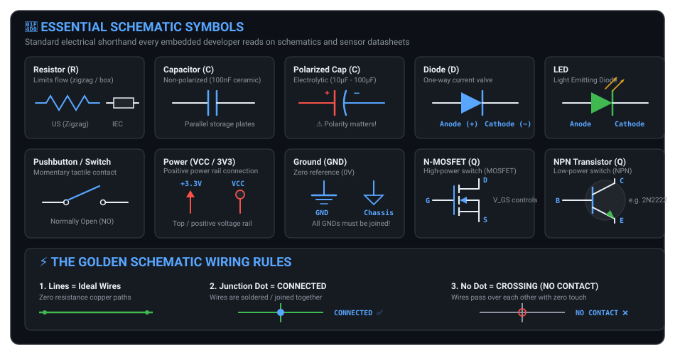
</p>

### Three Rules to Read Any Schematic:

1. **Lines are ideal wires** (zero resistance copper traces).
2. **A junction dot (•) where lines cross means CONNECTED.**
3. **No dot means the wires cross over without touching.**

> **In one sentence: Symbols are pictures of parts; lines are wires; a dot means connected.**

---

# PART R — Breadboard Basics

A breadboard lets you prototype circuits rapidly with zero soldering. Inside the plastic casing are hidden rows of spring-loaded phosphor bronze metal clips.

<p align="center">
  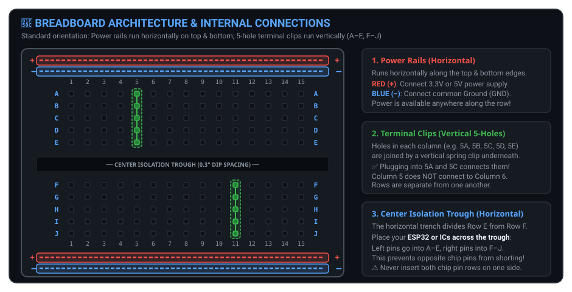
</p>

**Three golden rules:**

1. **Power rails (+ / −)** run horizontally. 3V3 → red rail. GND → blue rail.
2. **Each column of 5 holes (A-B-C-D-E)** is connected vertically. Plug a resistor into 1A and an LED into 1B → they're joined.
3. **The centre trough** separates the two halves. Put your ESP32 across it so left-side pins never touch right-side pins.

---

# PART S — Using a Multimeter

A multimeter is your **eyes** into the invisible world of electronics. It saves hundreds of hours of guesswork and prevents board burnouts.

<p align="center">
  
</p>

| Mode | Symbol | What it does | How to use it |
|---|---|---|---|
| **Continuity** | `•)))` | Beeps if two points are connected | Power OFF. Check your wiring before plugging in USB |
| **DC Voltage** | V= | Measures pressure between two points | Black probe on GND, red probe on the pin you're testing |
| **Resistance** | Ω | Measures a resistor's value | Power OFF. Check if it's really 220 Ω or 10 kΩ |
| **DC Current** | A / mA | Measures electron flow | ⚠️ Must be wired **in series** (break the loop). Never across power and ground — you'll blow the fuse |

### The safety habit that saves your board

**Before connecting USB, always:**
1. Set the multimeter to **continuity (`•)))`**.
2. Touch one probe to **3V3** and the other to **GND**.
3. **If it beeps → you have a short. Fix it. Do NOT plug in.**
4. **If it stays silent → you're safe.**

> **In one sentence: Beep-test your 3V3-to-GND before powering up — every single time.**

---

# PART T — SENSOR PROTOCOLS ⭐ (How Sensors Actually Talk to Your Board)

This is the part that matters most once you start connecting sensors. Read it slowly.

<p align="center">
  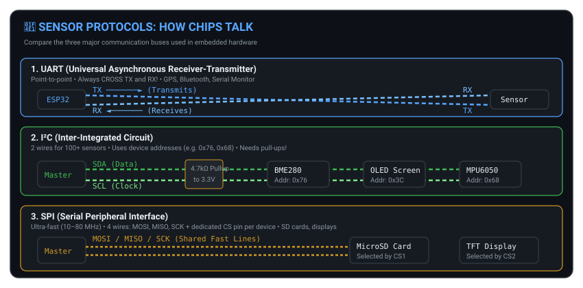
</p>

### T1. First, what is a "protocol"?

A protocol is just an **agreed way of talking**. Two chips can only exchange data if they agree on:

- **How many wires** are used
- **Who speaks first**
- **What "1" and "0" look like on the wire**
- **How fast** the data moves

Think of it as different languages: some sensors speak I²C, some speak SPI, some speak UART. Your board must speak the same language.

### T2. A pin can only do three things

Before protocols, understand what a single pin can be:

| Pin mode | What it does | Example |
|---|---|---|
| **GPIO (digital in/out)** | Reads or writes HIGH / LOW | Button, relay, LED |
| **ADC (analog in)** | Reads a voltage (0–4095) | Potentiometer, LDR, battery monitor |
| **PWM (fake analog out)** | Switches on/off very fast to average a voltage | Dimming an LED, servo, motor speed |

> 💡 **PWM explained simply:** If you switch a pin on for 50% of the time and off for 50%, the *average* voltage is 1.65 V — even though the pin is only ever 0 V or 3.3 V. That percentage is called the **duty cycle**.

---

### T3. SIMPLE SENSORS (no protocol needed)

Some sensors are so simple they just need one pin.

| Sensor type | How it connects | Examples |
|---|---|---|
| **Analog** | One wire to an ADC pin | Potentiometer, LDR (light), NTC (temperature), soil moisture |
| **Digital switch** | One wire to a GPIO pin | PIR motion, tilt switch, reed switch, flame sensor |
| **Pulse output** | One wire to a GPIO pin, chip counts pulses | DHT11 temperature, HC-SR04 ultrasonic |

**This is where you should start.** Analog sensors teach you ADC. Digital sensors teach you GPIO. No protocol knowledge required.

---

### T4. UART — the two-wire serial link

UART uses two dedicated communication lines (**TX** and **RX**) plus a shared **GND** (as shown in the Sensor Protocols diagram above):

| Feature | Details |
|---|---|
| Wires | 2 data (TX, RX) + GND |
| Direction | **TX** transmits, **RX** receives. **Cross them** — my TX goes to your RX |
| Speed | Set by **baud rate** — both sides must match (9600, 115200…) |
| Devices | **One to one only** (point-to-point) |
| Distance | Short — a few metres |

**Signals the ESP32 sends are also called UART** — that's what `Serial.println()` uses, and why you see it in the Serial Monitor.

**Typical uses:** GPS modules, HC-05 Bluetooth, fingerprint scanners, barcode scanners, XBee, most "module" boards.

> ⚠️ **Always cross TX↔RX.** If nothing works, this is the first thing to swap.

---

### T5. I²C — the two-wire bus (most popular for sensors)

I²C uses two open-drain bus lines (**SDA** and **SCL**) held high with **4.7 kΩ pull-up resistors** to 3.3 V (as illustrated in the Sensor Protocols diagram above):

| Feature | Details |
|---|---|
| Wires | 2 (**SDA** = data, **SCL** = clock) + GND |
| Devices | **Many on the same two wires** — each has a unique **address** |
| Address | 7 bits → 0x00 to 0x7F (about 112 usable) |
| Speed | 100 kHz (standard), 400 kHz (fast) |
| Pull-ups | **Required** — usually 4.7 kΩ to 3.3 V (many modules include them) |
| ESP32 default pins | SDA = GPIO 21, SCL = GPIO 22 (you can choose others) |

**How addresses work:** each sensor only answers when it hears its own address. It's like house numbers on a street — all houses share the same road, but only one opens the door.

> ⚠️ **Address clash:** if you buy two identical sensors, they both have the *same* address and can't share a bus. Either use a different sensor, a multiplexer (TCA9548A), or a second I²C bus.

**Typical uses:** OLED displays (SSD1306), BME280 weather sensor, MPU6050 motion sensor, RTC clocks, many pressure/light/IMU sensors.

> 💡 **I²C is the friendly default for beginners.** Fewer wires, easy to chain many sensors. If your sensor offers I²C, take it.

---

### T6. SPI — the four-wire fast bus

SPI uses four high-speed synchronous lines (**MOSI, MISO, SCK, CS**) plus GND (as illustrated in the Sensor Protocols diagram above):

| Feature | Details |
|---|---|
| Wires | 4 (**MOSI, MISO, SCK, CS**) + GND |
| Speed | **Very fast** — 10 MHz to 80 MHz |
| Devices | Many, but **each needs its own CS pin** |
| Addressing | None — the **CS pin** selects who is talking |
| Direction | Full duplex — can send and receive at the same time |

**How CS works:** the master pulls one device's CS pin LOW; that device listens; everyone else ignores the bus.

**Typical uses:** SD cards, TFT/OLED colour displays, LoRa modules (SX1278), Ethernet chips, MAX6675 thermocouples, flash memory.

> 💡 **Use SPI when you need speed or large data** — displays and SD cards are the classic cases.

---

### T7. 1-Wire — one wire, many sensors

| Feature | Details |
|---|---|
| Wires | 1 data wire + GND |
| Devices | Many on one wire — each has a unique 64-bit ID burned in at the factory |
| Speed | Slow (but that's fine for temperature) |
| Typical uses | **DS18B20 temperature sensors** — you can chain 20+ on one wire |

> 💡 Perfect when you want many temperature readings with almost no wiring.

---

### T8. Quick comparison table (screenshot this)

| | **UART** | **I²C** | **SPI** | **1-Wire** |
|---|---|---|---|---|
| Data wires | 2 (TX, RX) | 2 (SDA, SCL) | 4 (MOSI, MISO, SCK, CS) | 1 |
| Devices on one bus | 1 to 1 | Many | Many (extra CS each) | Many |
| Speed | Medium | Medium | **Fastest** | Slow |
| Needs pull-ups? | No | **Yes** | No | **Yes (4.7 kΩ)** |
| Complexity | Easy | Easy | Medium | Easy |
| Best for | Modules, GPS, debug | **Sensors, displays** | Displays, SD, radio | Temperature |

### T9. Which protocol should I pick?

- **Is it just a variable voltage?** $\to$ Use an **ADC pin** (analog input).
- **Is it just on / off?** $\to$ Use a standard **GPIO pin** (digital input).
- **Otherwise, check what the sensor supports:**
  - **Offers I²C?** $\to$ Use **I²C** (easiest for multi-sensor setups, only 2 shared pins).
  - **Offers SPI?** $\to$ Use **SPI** (ideal when high transmission speed is needed: screens, SD cards).
  - **Only UART?** $\to$ Use **UART** (for GPS, Bluetooth modules, serial modems).
  - **Only 1-Wire?** $\to$ Use **1-Wire** (for daisy-chaining DS18B20 temperature probes).

> 🌟 **Golden rule of buying sensors: check which protocol it uses BEFORE you buy it, and make sure it works at 3.3 V.**

---

# PART U — Your First Three Mini-Projects

Do these in order. Each one uses only what you learned above.

<p align="center">
  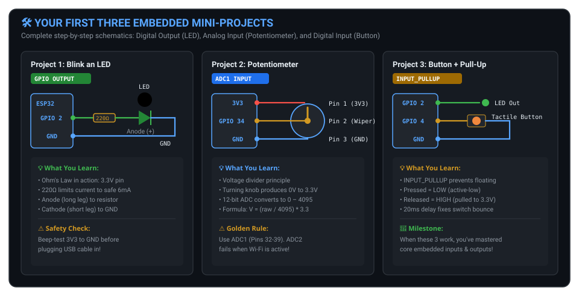
</p>

### Project 1 — Blink an LED (GPIO output)

**Teaches:** Ohm's law, resistor sizing, digital output.
- **Wiring:** Connect **ESP32 GPIO 2** to a **220 Ω** resistor $\to$ LED Anode (long leg) $\to$ LED Cathode (short leg) $\to$ **GND**.

```cpp
void setup()  { pinMode(2, OUTPUT); }
void loop()   { digitalWrite(2, HIGH); delay(500);
                digitalWrite(2, LOW);  delay(500); }
```

> Before plugging in USB: **beep-test 3V3 to GND with your multimeter.**

---

### Project 2 — Read a potentiometer (ADC input)

**Teaches:** the ADC, the universal formula, thresholds.
- **Wiring:** Potentiometer Terminal 1 to **3V3**, Terminal 2 (middle wiper) to **GPIO 34 (ADC1)**, and Terminal 3 to **GND**.

```cpp
void setup() {
    Serial.begin(115200);
    analogReadResolution(12);
    analogSetAttenuation(ADC_11db);
}

void loop() {
    int raw = analogRead(34);                       // 0 … 4095
    float v = (raw / 4095.0) * 3.3;                 // the universal formula
    float percent = (raw / 4095.0) * 100.0;
    Serial.printf("Raw: %4d | %.3f V | %.1f%%\n", raw, v, percent);
    delay(250);
}
```

---

### Project 3 — A button that lights the LED (pull-up + debounce)

**Teaches:** floating pins, pull-ups, active-low, debounce.
- **Wiring:** Momentary tactile button connected directly between **GPIO 4** and **GND** (leveraging internal `INPUT_PULLUP`), with the indicator LED on **GPIO 2**.

```cpp
void setup() {
    pinMode(2, OUTPUT);
    pinMode(4, INPUT_PULLUP);        // internal pull-up
}

void loop() {
    if (digitalRead(4) == LOW) {     // pressed = LOW (active-low)
        delay(20);                   // debounce
        if (digitalRead(4) == LOW) {
            digitalWrite(2, HIGH);
            while (digitalRead(4) == LOW);   // wait for release
            digitalWrite(2, LOW);
        }
    }
}
```

**Once these three work, you are officially past the beginner barrier.**

---

# PART V — Final Checklist and Mini Glossary

### ✅ Can you honestly say yes to all of these?

- [ ] Can I explain voltage, current and resistance using the water analogy?
- [ ] Can I use `V = I × R` to calculate an LED resistor?
- [ ] Do I know the difference between series and parallel by heart?
- [ ] Can I explain digital vs analog signals?
- [ ] Can I explain why the ESP32 ADC maximum is **4095** and not 4096?
- [ ] Can I use `Voltage = (raw ÷ 4095) × 3.3` without thinking?
- [ ] Do I understand why 5 V into a 3.3 V pin permanently kills it?
- [ ] Can I explain what a floating pin is and why a pull-up fixes it?
- [ ] Do I know why a capacitor stops Wi-Fi brownout resets?
- [ ] Can I explain the Common Ground rule?
- [ ] Can I name the wires of UART, I²C and SPI?
- [ ] Can I pick the right protocol for a new sensor?

If everything is ticked, you're ready. 🚀

### 📖 Mini Glossary

| Term | Plain meaning |
|---|---|
| **V (volt)** | Electrical push |
| **I (amp)** | Electrical flow rate |
| **R (ohm)** | Opposition to flow |
| **GND** | The shared zero reference |
| **GPIO** | A pin that reads/writes HIGH or LOW |
| **ADC** | Turns a voltage into a number |
| **PWM** | Fast on/off to fake an average voltage |
| **Pull-up / pull-down** | A resistor that gives an idle pin a fixed value |
| **Voltage divider** | Two resistors that scale a voltage down |
| **Brownout** | The supply voltage dips and the chip resets |
| **Bounce** | Mechanical chatter when a button is pressed |
| **Flyback diode** | A diode that absorbs a coil's voltage spike |
| **UART** | 2-wire serial link (TX/RX), one-to-one |
| **I²C** | 2-wire bus (SDA/SCL), many devices, uses addresses |
| **SPI** | 4-wire bus (MOSI/MISO/SCK/CS), fastest |
| **1-Wire** | 1 data wire, many devices, each with a unique ID |
| **3V3** | The ESP32's 3.3 V supply pin |
| **V_f** | Forward voltage — the voltage an LED "steals" to switch on |

---

> [!TIP]
> ### 🎯 The Five Golden Rules to Never Forget
> 1. **Electricity needs a complete loop** — unbroken path from power source through your circuit and back to Ground.
> 2. **Ohm's Law is universal ($V = I \times R$)** — if you know two, you always know the third.
> 3. **3.3 V board + 5 V signal = dead pin** — always level-shift or divide 5 V signals down to $\le 3.3\text{ V}$.
> 4. **Protect vulnerable components** — every LED needs an inline resistor; every inductive coil needs a flyback diode.
> 5. **Common Ground & Beep-Test** — tie every single Ground (GND) pin together, and continuity beep-test 3V3-to-GND before plugging in USB!
