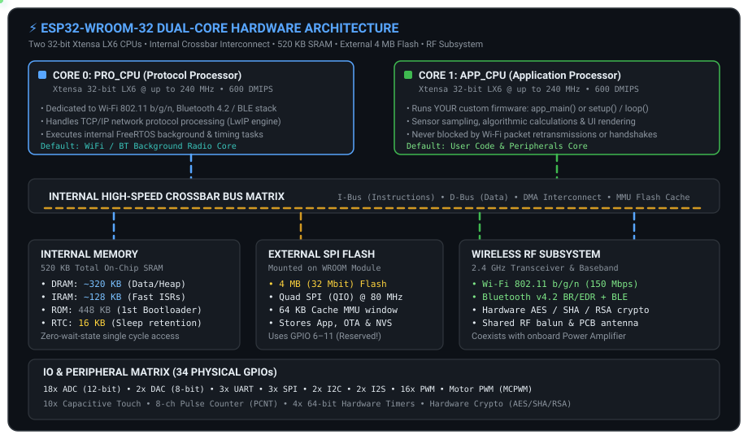
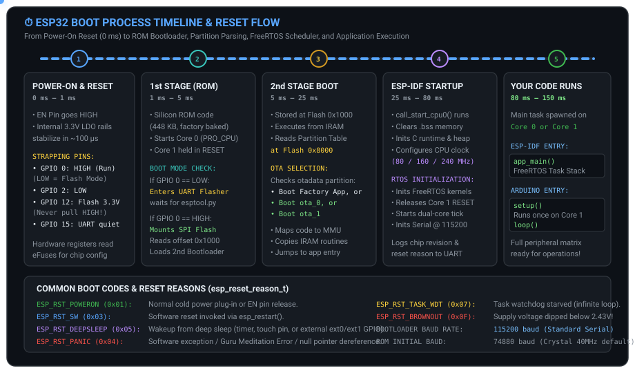
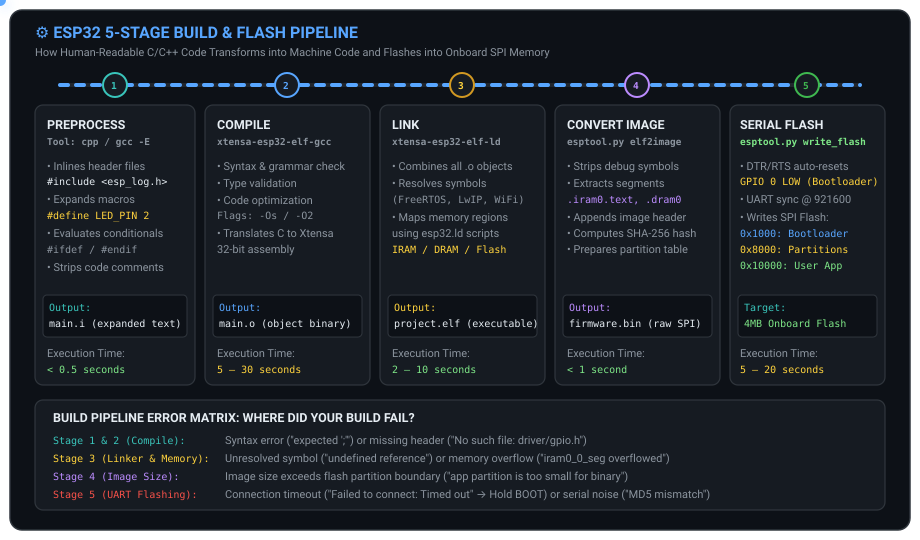
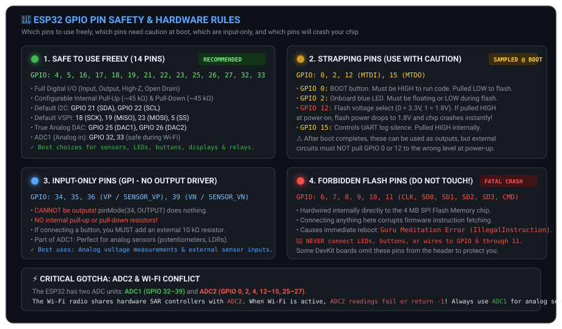
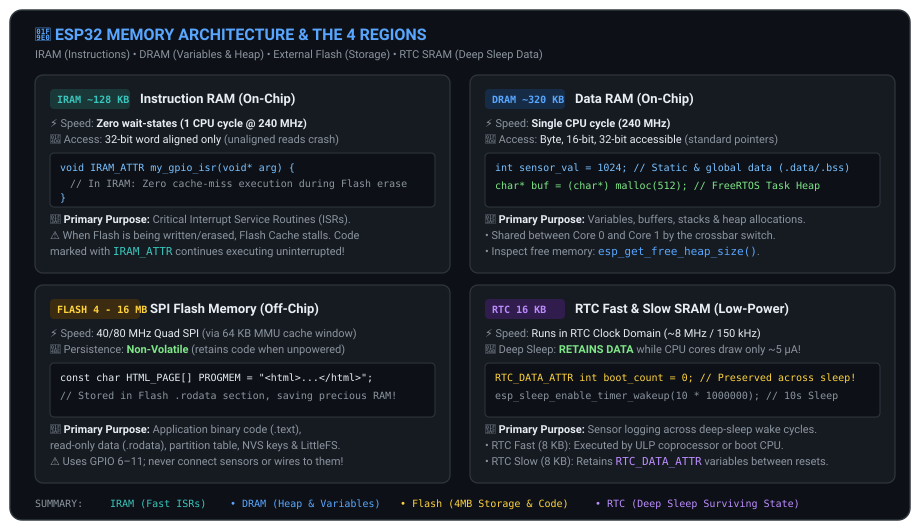
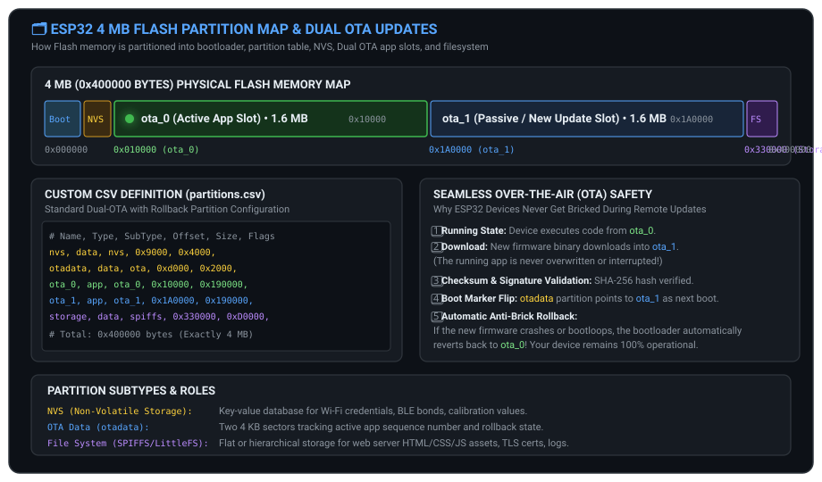

# ⚡ Phase 1: Architecture & Foundations (Days 1–8)

> **Platform**: `ESP32-WROOM-32` (Xtensa Dual-Core 32-bit LX6 @ 240 MHz, 520 KB SRAM, 4 MB SPI Flash)  
> **Roadmap Context**: [Master Roadmap](../../README.md#-the-350-day-execution-roadmap) | [Daily Tracker](../../DAILY_TRACKER.md)  
> **Milestone Project**: Industrial System Profiler & Hardware Diagnostics Firmware (`day01_sysinfo_starter/`)

---

## 🎯 Phase Overview & Objectives

Phase 1 establishes the bedrock engineering principles of the ESP32 platform. Rather than treating the ESP32 as a black-box microcontroller, this phase tears down the silicon architecture to uncover how the dual-core processor functions, how memory is partitioned across on-chip SRAM and external SPI Flash, how the multi-stage bootloader initializes the system, and how to build modular, production-ready firmware using enterprise toolchains.

```
                         PHASE 1 CURRICULUM ARCHITECTURE
  ┌─────────────────────────────────────────────────────────────────────────────┐
  │ DAY 1: Hardware Architecture • Dual-Core Xtensa LX6 • Bus Matrix Interconnect│
  ├─────────────────────────────────────────────────────────────────────────────┤
  │ DAY 2: First Program • Serial Telemetry • Boot Log Autopsy • Reset Reasons  │
  ├─────────────────────────────────────────────────────────────────────────────┤
  │ DAY 3: Toolchains (ESP-IDF & Arduino IDE) • GPIO Safety Hierarchy & Rules   │
  ├─────────────────────────────────────────────────────────────────────────────┤
  │ DAY 4: 4-Tier Memory Model (DRAM, IRAM, Flash, RTC) • Dynamic Allocation     │
  ├─────────────────────────────────────────────────────────────────────────────┤
  │ DAY 5: Flash Partition Tables • Dual-Slot OTA Update Architecture           │
  ├─────────────────────────────────────────────────────────────────────────────┤
  │ DAY 6: Build System Mastery • CMake Component Architecture • Kconfig Menus  │
  ├─────────────────────────────────────────────────────────────────────────────┤
  │ DAY 7: Production Logging Framework • Log Filtering • Runtime Telemetry     │
  ├─────────────────────────────────────────────────────────────────────────────┤
  │ DAY 8: Phase Milestone Project: Full System Profiler & Diagnostics Firmware │
  └─────────────────────────────────────────────────────────────────────────────┘
```

---

## 📅 Daily Execution & Topic Matrix

| Status | Day | Module & Engineering Focus | Key Concepts & Deliverables | Completed Date |
| :---: | :---: | :--- | :--- | :---: |
| [x] | **1** | [System Architecture](#-day-1--esp32-hardware-architecture--dual-core-computing) | Dual-Core Xtensa LX6, Bus Matrix, PRO_CPU vs APP_CPU, Hardware specs | 2026-10-15 |
| [x] | **2** | [Boot Process & First Code](#-day-2--boot-process-telemetry--first-program) | Boot stages (0–150ms), UART 115200 logs, Reset reasons (`esp_reset_reason_t`) | 2026-10-15 |
| [x] | **3** | [Toolchains & Pin Safety](#-day-3--toolchains--gpio-pinout-safety-rules) | Native ESP-IDF CMake workflow, Safe GPIOs, Strapping pins, Input-only, Flash | 2026-10-15 |
| [x] | **4** | [Memory Organization](#-day-4--the-4-memory-tiers--dynamic-allocation) | IRAM (`IRAM_ATTR`), DRAM, External Flash, RTC SRAM (`RTC_DATA_ATTR`), Heap | 2026-10-15 |
| [x] | **5** | [Flash Partition Tables](#-day-5--flash-partition-tables--dual-ota-updates) | Custom CSV maps, Factory vs Dual-OTA slots, Anti-brick rollback, NVS, SPIFFS | 2026-10-15 |
| [x] | **6** | [Build System Mastery](#-day-6--build-system-mastery--component-architecture) | CMakeLists.txt structure, `idf_component_register`, Kconfig menus | 2026-10-15 |
| [x] | **7** | [Logging Framework](#-day-7--industrial-logging-framework--telemetry) | `ESP_LOGE/W/I/D/V`, ANSI colored output, runtime tag filtering, UART sinks | 2026-10-15 |
| [x] | **8** | [Milestone Project](#-day-8--milestone-project-system-profiler--diagnostics) | Complete System Profiler firmware inspecting silicon, MAC, heap, and Flash | 2026-10-15 |

---

## 🏛️ DAY 1 — ESP32 Hardware Architecture & Dual-Core Computing

### 1.1 What is the ESP32?

The **ESP32-WROOM-32** is a complete System-on-Chip (SoC) packaged inside a surface-mount metal shield module. Unlike traditional 8-bit microcontrollers that execute instructions sequentially on a single thread at modest speeds, the ESP32 contains **two independent 32-bit processor cores** capable of running at clock speeds up to **240 MHz**, delivering combined compute performance of over **600 DMIPS** (Dhrystone Million Instructions Per Second).

```
┌─────────────────────────────────────────────────────────────────────────────┐
│                       ESP32 HARDWARE SPECIFICATIONS                         │
├───────────────────────┬─────────────────────────────────────────────────────┤
│ Processor Architecture│ Dual-Core 32-bit Xtensa LX6 Microprocessors         │
│ Maximum Clock Speed   │ 240 MHz (Adjustable to 80 MHz, 160 MHz, or 240 MHz) │
│ Internal SRAM         │ 520 KB on-chip SRAM (IRAM + DRAM)                   │
│ Internal ROM          │ 448 KB on-chip ROM (First-stage Bootloader)         │
│ Low-Power Memory      │ 16 KB RTC SRAM (Fast & Slow domains)                │
│ External Flash Memory │ 4 MB (32 Mbit) Quad-SPI Flash @ 80 MHz              │
│ Wireless Connectivity │ Wi-Fi 802.11 b/g/n (150 Mbps) + Bluetooth 4.2 / BLE │
│ Physical GPIO Count   │ 34 accessible General Purpose Input/Output pins     │
│ Operating Voltage     │ 3.0V to 3.6V DC (Standard 3.3V Logic Levels)        │
│ Current Consumption   │ ~80–240 mA (Active RF), ~5 µA (Deep Sleep)          │
└───────────────────────┴─────────────────────────────────────────────────────┘
```

### 1.2 The Dual-Core Concept: The Two-Chef Analogy

Imagine a high-volume restaurant kitchen with **two chefs working side-by-side**:

```
                       THE DUAL-CORE RESTAURANT KITCHEN
  ┌─────────────────────────────────┐     ┌─────────────────────────────────┐
  │     CHEF 0 (Core 0: PRO_CPU)    │     │     CHEF 1 (Core 1: APP_CPU)    │
  │    "The Background Specialist"  │     │     "The Executive Head Chef"   │
  ├─────────────────────────────────┤     ├─────────────────────────────────┤
  │ • Manages Wi-Fi connections     │     │ • Runs YOUR code: setup/loop    │
  │ • Handles Bluetooth handshakes  │     │ • Reads sensors (ADC, I2C, SPI) │
  │ • Runs TCP/IP networking (LwIP) │     │ • Controls actuators and motors │
  │ • Services radio interrupts     │     │ • Updates displays & GUI frames │
  │ • Works silently in background  │     │ • Executes application logic    │
  └─────────────────────────────────┘     └─────────────────────────────────┘
                   │                                       │
                   └───────────────────┬───────────────────┘
                                       ▼
                       SHARED CROSSBAR BUS MATRIX & RAM
          (Both chefs share the same 520 KB refrigerator and storage)
```

1. **Core 0 (`PRO_CPU` — Protocol CPU)**: Dedicated by default to time-critical wireless communications. When a Wi-Fi packet arrives or an encrypted TLS handshake occurs, Core 0 handles it immediately without interfering with sensor sampling.
2. **Core 1 (`APP_CPU` — Application CPU)**: Dedicated to executing your custom application logic (`app_main()` in ESP-IDF, or `setup()` and `loop()` in Arduino). Because your application runs on Core 1, heavy computational tasks or display updates will **never stall Wi-Fi packet delivery**, and heavy network traffic will **never introduce jitter into your sensor control loops**.

### 1.3 Architectural Block Diagram

The internal architecture links the dual cores to memory blocks, DMA channels, and peripheral interfaces through a high-bandwidth **Crossbar Bus Matrix**:



### 1.4 Technical Comparison: ESP32 vs Classic Microcontrollers

| Parameter | Arduino Uno (ATmega328P) | STM32 BluePill (Cortex-M3) | ESP32-WROOM-32 (Xtensa LX6) | Architectural Impact |
| :--- | :---: | :---: | :---: | :--- |
| **CPU Cores** | 1 core, 8-bit | 1 core, 32-bit | **2 cores, 32-bit** | True hardware multitasking without task starvation |
| **Clock Frequency** | 16 MHz | 72 MHz | **240 MHz** | **15x faster** than Uno; handles real-time cryptography |
| **RAM** | 2 KB | 20 KB | **520 KB** | **260x more RAM**; can buffer audio, web pages, and TLS |
| **Flash Storage** | 32 KB | 64 KB | **4,096 KB (4 MB)** | **128x more storage**; stores web assets and dual OTA images |
| **Wireless Radio** | None (External shield) | None (External shield) | **Wi-Fi + BLE Built-in** | Native cloud IoT connectivity without external wiring |
| **Logic Voltage** | 5.0 V | 3.3 V | **3.3 V** | Standard modern low-power CMOS logic levels |
| **OS Support** | Bare-metal | Bare-metal / FreeRTOS | **Native FreeRTOS** | Built-in symmetric multiprocessing (SMP) scheduler |

---

## ⏱️ DAY 2 — Boot Process, Telemetry & First Program

### 2.1 The 0 to 150 ms Boot Sequence

When 3.3V power is applied to the ESP32 (or when the `EN` pin transitions from `LOW` to `HIGH`), the chip undergoes an engineered four-stage initialization before a single line of your custom code executes:



```
BOOT TIMELINE:
  0 ms ─────────► 1 ms ─────────► 5 ms ─────────► 25 ms ────────► 80 ms ────────► 150 ms
  [Power-On]      [Strapping]     [1st ROM Boot]  [2nd Bootloader][ESP-IDF RTOS] [Your Code]
   VCC stabilizes  GPIO 0/2/12/15  Silicon ROM     Flash 0x1000    call_start_cpu0 app_main()
   Reset released  latched by HW   checks GPIO 0   loads IRAM/DRAM inits scheduler setup/loop
```

1. **Stage 1: Power-On Reset & Strapping Latch (0–1 ms)**:
   - The power-on reset circuit holds the CPU in reset until internal voltage regulators stabilize at 3.3V.
   - The hardware samples the **strapping pins** (`GPIO 0`, `GPIO 2`, `GPIO 12`, `GPIO 15`). The logic levels on these pins determine whether the chip boots normally from SPI Flash or enters UART download flashing mode.
2. **Stage 2: 1st Stage Bootloader in Silicon ROM (1–5 ms)**:
   - Hardcoded into 448 KB of read-only silicon during factory fabrication.
   - Core 0 starts executing from ROM address `0x40000800`; Core 1 is held in hardware reset.
   - If `GPIO 0` is `LOW`, the ROM bootloader halts and awaits serial firmware upload via `esptool.py`.
   - If `GPIO 0` is `HIGH`, the ROM bootloader configures the SPI Flash controller, reads the flash header at offset `0x1000`, and copies the 2nd Stage Bootloader into IRAM.
3. **Stage 3: 2nd Stage Bootloader (5–25 ms)**:
   - Stored in SPI Flash at offset `0x1000`.
   - Reads the **Partition Table** at offset `0x8000`.
   - Checks the `otadata` partition to determine whether to boot the `factory` app, `ota_0`, or `ota_1`.
   - Maps `.rodata` and `.text` code into virtual memory via the hardware Flash Cache MMU, copies critical routines into IRAM, and jumps to the application entry point.
4. **Stage 4: ESP-IDF Startup & RTOS Scheduling (25–80 ms)**:
   - `call_start_cpu0()` clears the `.bss` memory region, initializes the system heap memory allocator, and configures the CPU clock to its target speed (typically 160 or 240 MHz).
   - Initializes the FreeRTOS symmetric multiprocessing kernel, takes Core 1 out of reset, and launches the default system tasks.
   - Spawns the main user task and jumps to `app_main()` (ESP-IDF) or launches `loopTask()` (Arduino).

### 2.2 Boot Log Autopsy: Decoding UART Output at 115200 Baud

When you connect a serial monitor to the ESP32 at **115200 baud** and press the `EN` (Reset) button, the chip outputs its startup telemetry:

```text
rst:0x1 (POWERON_RESET),boot:0x13 (SPI_FAST_FLASH_BOOT)
configsip: 0, SPIWP:0xee
clk_drv:0x00,q_drv:0x00,d_drv:0x00,cs0_drv:0x00,hd_drv:0x00,wp_drv:0x00
mode:DIO, clock div:2
load:0x3fff0030,len:6644
load:0x40078000,len:14848
ho 0 tail 12 room 4
load:0x40080400,len:3792
entry 0x40080694
I (27) boot: ESP-IDF v5.1.2 2nd stage bootloader
I (27) boot: compile time Feb 12 2026 10:22:15
I (29) boot: chip revision: v3.0
I (32) boot.esp32: SPI Speed      : 40MHz
I (37) boot.esp32: SPI Mode       : DIO
I (41) boot.esp32: SPI Flash Size : 4MB
I (46) boot: Partition Table:
I (49) boot: ## Label            Usage          Type ST Offset   Length
I (57) boot:  0 nvs              WiFi data        01 02 00009000 00006000
I (64) boot:  1 phy_init         RF data          01 01 0000f000 00001000
I (72) boot:  2 factory          factory app      00 00 00010000 00100000
I (79) boot: End of partition table
I (84) esp_image: segment 0: paddr=00010020 vaddr=3f400020 size=0963ch ( 38460) map
I (106) esp_image: segment 1: paddr=00019664 vaddr=3ffb0000 size=02488h (  9352) load
I (110) esp_image: segment 2: paddr=0001baf4 vaddr=40080000 size=04524h ( 17700) load
I (123) main_task: Calling app_main()
```

```
                          KEY TELEMETRY FIELDS DECODED
  • rst:0x1 (POWERON_RESET)  ──► Indicates clean power supply plug-in or EN button press.
  • boot:0x13                ──► Strapping pin status (0x13 = GPIO 0 HIGH, normal boot).
  • mode:DIO, clock div:2    ──► Dual I/O SPI flash mode running at 40 MHz.
  • load:0x40080400          ──► Critical routines being copied directly into on-chip IRAM.
  • entry 0x40080694         ──► Program counter jumping to 2nd Stage Bootloader entry point.
```

### 2.3 Hardware Reset Reasons Reference (`esp_reset_reason_t`)

When debugging erratic hardware reboots, query `esp_reset_reason()` to determine the exact silicon trigger:

| Return Code | Enumeration Constant | Physical Hardware Cause | Troubleshooting Action |
| :---: | :--- | :--- | :--- |
| `0x01` | `ESP_RST_POWERON` | Clean power plug-in or `EN` pin release | Normal behavior on startup. |
| `0x03` | `ESP_RST_SW` | Software reboot via `esp_restart()` | Intentional firmware reboot. |
| `0x04` | `ESP_RST_PANIC` | Software crash / Guru Meditation Exception | Null pointer, stack overflow, or memory corruption. |
| `0x05` | `ESP_RST_DEEPSLEEP`| Wakeup from Deep Sleep mode | Expected wakeup from timer, touch, or external GPIO. |
| `0x06` | `ESP_RST_TG0WDT` | Main System Watchdog Timer expired | A task blocked execution on Core 0 for >5 seconds. |
| `0x07` | `ESP_RST_TG1WDT` | Secondary Watchdog Timer expired | A task blocked execution on Core 1 for >5 seconds. |
| `0x08` | `ESP_RST_TASK_WDT` | FreeRTOS Task Watchdog starved | An infinite loop without `vTaskDelay()` starved the idle task. |
| `0x0F` | `ESP_RST_BROWNOUT` | Supply voltage dipped below ~2.43V | Insufficient USB current; add a 470 µF decoupling capacitor! |

---

## 🚦 DAY 3 — Toolchains & GPIO Pinout Safety Rules

### 3.1 Toolchain Selection: Native ESP-IDF vs Arduino IDE

```
                            TOOLCHAIN COMPARISON MATRIX
  ┌───────────────────────────────┬───────────────────────────────┐
  │     NATIVE ESP-IDF C/C++      │        ARDUINO IDE C++        │
  │    (Industry Professional)    │     (Rapid Prototyping)       │
  ├───────────────────────────────┼───────────────────────────────┤
  │ • Native CMake build engine   │ • Simplified sketch workflow  │
  │ • Direct FreeRTOS SMP API     │ • Massive library ecosystem   │
  │ • Fine-grained memory tuning  │ • Abstracted hardware drivers │
  │ • Interactive Kconfig menus   │ • Faster initial bring-up     │
  │ • Complete hardware control   │ • Limited multi-core control  │
  │ • Used in production products │ • Excellent for quick proofs  │
  └───────────────────────────────┴───────────────────────────────┘
```

### 3.2 Step-by-Step Software Download & Setup Guide

#### Part A: USB-to-UART Bridge Hardware Drivers
The ESP32 communicates with your computer over a USB-to-UART bridge converter chip soldered onto the development board. If your operating system does not recognize the board when plugged in, install the appropriate manufacturer VCP (Virtual COM Port) driver:

1. **Silicon Labs CP2102 / CP2104**:
   - Download: [Silicon Labs CP210x USB to UART Bridge VCP Drivers](https://www.silabs.com/developers/usb-to-uart-bridge-vcp-drivers)
   - Supports: Most standard NodeMCU-32S and official Espressif DevKitC boards.
2. **WCH CH340 / CH341**:
   - Download: [WCH CH340/CH341 Windows Driver](http://www.wch-ic.com/downloads/CH341SER_ZIP.html)
   - Supports: Budget ESP32 development boards.
3. **How to Verify on Windows**:
   - Press `Win + X` $\to$ select **Device Manager**.
   - Expand the **Ports (COM & LPT)** section.
   - Plug in your ESP32 board via USB.
   - You should see an entry appear, e.g., `Silicon Labs CP210x USB to UART Bridge (COM3)` or `USB-SERIAL CH340 (COM4)`. Note this COM port number!

---

#### Part B: VS Code + Official Espressif ESP-IDF Extension (Industry Standard)

1. **Step 1: Install Visual Studio Code**
   - Download and install the latest stable build for your OS: [https://code.visualstudio.com/](https://code.visualstudio.com/).
2. **Step 2: Install Supporting Tools**
   - **Git**: Download and install [https://git-scm.com/](https://git-scm.com/) (Required for cloning submodules).
   - **Python 3.10+**: Download and install [https://www.python.org/](https://www.python.org/) (Ensure *"Add Python to PATH"* is checked during setup).
3. **Step 3: Install the Official ESP-IDF Extension**
   - Open VS Code.
   - Press `Ctrl + Shift + X` to open the Extensions marketplace.
   - Search for `ESP-IDF` (published by **Espressif Systems**).
   - Click **Install**.
4. **Step 4: Run Express Configuration**
   - Press `F1` (or `Ctrl + Shift + P`) to open the Command Palette.
   - Type: `ESP-IDF: Configure ESP-IDF Extension` and hit Enter.
   - Select **EXPRESS** configuration.
   - Select your target framework version: Choose **ESP-IDF v5.2.x** or **v5.1.x** (Stable).
   - Choose paths for the framework and tools (defaults in `C:\Users\<user>\esp` are recommended).
   - Click **Install**. The extension will automatically download the Xtensa toolchain compiler (`xtensa-esp32-elf-gcc`), Ninja, CMake, and configure an isolated Python virtual environment (~15–20 minutes).
5. **Step 5: Create a Sample Project**
   - Press `F1` $\to$ type `ESP-IDF: Create Project from Extension Template`.
   - Select your desired directory $\to$ choose **ESP-IDF** $\to$ select `sample_project`.
   - Your project is generated with `CMakeLists.txt`, `sdkconfig`, and `main/main.c`.
6. **Step 6: VS Code Status Bar Controls**
   - Look at the bottom blue status bar in VS Code for one-click shortcuts:
     - 🎯 **Target**: Set to `esp32`.
     - 🔌 **COM Port**: Select the COM port identified in Device Manager.
     - ⚙️ **menuconfig**: Opens the interactive configuration GUI.
     - 🔨 **Build**: Compiles the project (`idf.py build`).
     - ⚡ **Flash**: Writes binary to device (`idf.py flash`).
     - 🖥️ **Monitor**: Opens real-time serial output (`idf.py monitor`).

---

#### Part C: Arduino IDE 2.x Setup (Rapid Prototyping)

1. **Step 1: Download & Install Arduino IDE 2.x**
   - Download the installer from the official site: [https://www.arduino.cc/en/software](https://www.arduino.cc/en/software).
2. **Step 2: Add Espressif Board Package URL**
   - Open Arduino IDE $\to$ Go to **File $\to$ Preferences** (or press `Ctrl + ,`).
   - In the **Additional boards manager URLs** field, paste:
     ```text
     https://espressif.github.io/arduino-esp32/package_esp32_index.json
     ```
   - Click **OK**.
3. **Step 3: Install the ESP32 Platform Core**
   - Click the **Boards Manager** icon on the left sidebar (or press `Ctrl + Shift + B`).
   - Search for `esp32` by **Espressif Systems**.
   - Click **Install** (installs toolchains, headers, and hardware libraries).
4. **Step 4: Select Board & Configure Upload Parameters**
   - Go to **Tools $\to$ Board $\to$ esp32 $\to$ ESP32 Dev Module**.
   - Go to **Tools $\to$ Port** and select your active `COMx` port.
   - Recommended settings under **Tools**:
     - **CPU Frequency**: `240MHz (WiFi/BT)`
     - **Flash Frequency**: `80MHz`
     - **Flash Mode**: `QIO` (or `DIO`)
     - **Upload Speed**: `921600` (Fastest; reduce to `115200` if write errors occur).

---

### 3.3 Professional ESP-IDF Command Line Workflow (idf.py)
```bash
# 1. Select the silicon target (ESP32-WROOM-32)
idf.py set-target esp32

# 2. Launch interactive hardware & component configuration menu
idf.py menuconfig

# 3. Compile firmware binaries (bootloader, partitions, app)
idf.py build

# 4. Flash binary to device over USB Serial and open real-time monitor
idf.py -p COM3 flash monitor

# Note: Press Ctrl + ] to exit the ESP-IDF serial monitor cleanly.
```

### 3.4 The 5-Stage Build & Flash Pipeline

When you run `idf.py build flash` or click Upload in Arduino IDE, the toolchain executes a five-stage transformation pipeline:



```
                       5-STAGE BUILD & FLASH PIPELINE
  [Source Code] ──► 1. Preprocessor (gcc -E) ──► 2. Compiler (xtensa-gcc)
                         │                              │
                         ▼                              ▼
                 Inlines #headers              Converts C to Xtensa
                 Expands #defines              LX6 Machine Code (.o)
                         │                              │
                         └──────────────┬───────────────┘
                                        ▼
                           3. Linker (xtensa-ld)
                         (Maps IRAM/DRAM/Flash via esp32.ld ──► .elf)
                                        │
                                        ▼
                       4. Binary Converter (elf2image)
                         (Strips debug symbols, packages firmware.bin)
                                        │
                                        ▼
                       5. Serial Flasher (esptool.py)
                         (UART DTR/RTS auto-reset ──► SPI Flash @ 921600)
```

### 3.5 Side-by-Side: The Same Blink Program Under the Hood

```c
// ==================== ARDUINO IDE C++ ====================
// Abstracted, high-level API
void setup() {
    Serial.begin(115200);
    pinMode(2, OUTPUT);
}
void loop() {
    digitalWrite(2, HIGH);
    delay(1000);
    digitalWrite(2, LOW);
    delay(1000);
}

// ==================== NATIVE ESP-IDF C ====================
// Pure C, zero-overhead FreeRTOS task, direct driver access
#include "freertos/FreeRTOS.h"
#include "freertos/task.h"
#include "driver/gpio.h"
#include "esp_log.h"

#define BLINK_GPIO GPIO_NUM_2
static const char *TAG = "BLINK";

void app_main(void) {
    gpio_config_t io_conf = {
        .pin_bit_mask = (1ULL << BLINK_GPIO),
        .mode = GPIO_MODE_OUTPUT,
        .pull_up_en = GPIO_PULLUP_DISABLE,
        .pull_down_en = GPIO_PULLDOWN_DISABLE,
        .intr_type = GPIO_INTR_DISABLE,
    };
    gpio_config(&io_conf);

    while (1) {
        gpio_set_level(BLINK_GPIO, 1);
        ESP_LOGI(TAG, "LED ON");
        vTaskDelay(pdMS_TO_TICKS(1000));

        gpio_set_level(BLINK_GPIO, 0);
        ESP_LOGI(TAG, "LED OFF");
        vTaskDelay(pdMS_TO_TICKS(1000));
    }
}
```

> **Silicon Under-the-Hood Note:** When Arduino's `digitalWrite(2, HIGH)` executes, it internally calls ESP-IDF's `gpio_set_level(GPIO_NUM_2, 1)`, which writes a `1` directly into bit 2 of the 32-bit hardware register `GPIO_OUT_W1TS_REG` at physical address `0x3FF44008`.

### 3.6 GPIO Pin Safety Hierarchy

The ESP32 multiplexes 34 physical GPIO pins through an internal **GPIO Matrix**. However, hardware connections to the internal SPI Flash and strapping pins impose strict usage rules:



```
                            ESP32 PIN SAFETY CLASSIFICATION
  ┌─────────────────────────────────────────────────────────────────────────────┐
  │ 🟢 SAFE EVERYWHERE (14 PINS)                                                │
  │ GPIO 4, 5, 16, 17, 18, 19, 21, 22, 23, 25, 26, 27, 32, 33                   │
  │ Full digital input/output, configurable internal pull-up and pull-down.     │
  │ Default I2C: 21 (SDA), 22 (SCL) • Default SPI: 18 (SCK), 19 (MISO), 23 (MOSI)│
  ├─────────────────────────────────────────────────────────────────────────────┤
  │ 🟡 STRAPPING PINS — CAUTION AT BOOT (4 PINS)                                │
  │ • GPIO 0  : Connected to BOOT button. Must be HIGH to run; pull LOW to flash│
  │ • GPIO 2  : On-board blue LED. Must be floating or LOW during flashing      │
  │ • GPIO 12 : MTDI flash voltage select (0=3.3V, 1=1.8V). Pulling HIGH crashes │
  │ • GPIO 15 : MTDO controls UART boot silence. Pulled HIGH internally          │
  ├─────────────────────────────────────────────────────────────────────────────┤
  │ 🔵 INPUT ONLY — NO OUTPUT DRIVER (4 PINS)                                   │
  │ GPIO 34, 35, 36 (SENSOR_VP), 39 (SENSOR_VN)                                 │
  │ CANNOT be outputs! NO internal pull-up or pull-down resistors!               │
  │ Must use external 10 kΩ resistors when connecting push buttons.            │
  ├─────────────────────────────────────────────────────────────────────────────┤
  │ 🔴 FORBIDDEN — INTERNAL SPI FLASH (6 PINS)                                  │
  │ GPIO 6, 7, 8, 9, 10, 11 (CLK, SD0, SD1, SD2, SD3, CMD)                      │
  │ Hardwired directly to the 4 MB SPI flash chip. Touching these causes an     │
  │ immediate Fatal Exception / Guru Meditation Reboot! Never wire anything here│
  ├─────────────────────────────────────────────────────────────────────────────┤
  │ ⚠️ CRITICAL SILICON CONFLICT: ADC2 & WI-FI                                  │
  │ ADC2 channels (GPIO 0, 2, 4, 12–15, 25–27) share silicon with the Wi-Fi RF │
  │ baseband. When Wi-Fi is active, ADC2 readings FAIL or return -1!            │
  │ ALWAYS use ADC1 (GPIO 32, 33, 34, 35, 36, 39) for analog sensor readings.  │
  └─────────────────────────────────────────────────────────────────────────────┘
```

---

## 🧠 DAY 4 — The 4 Memory Tiers & Dynamic Allocation

### 4.1 The 4 Memory Regions Explained

The ESP32 employs a tiered memory architecture engineered to balance execution speed, power consumption, and storage capacity:



```
                            THE 4 MEMORY REGIONS ANALOGY
  ┌───────────────┬─────────────────────────────┬──────────────┬────────────────┐
  │ Memory Region │ Everyday Workspace Analogy  │ Physical Size│ Access Speed   │
  ├───────────────┼─────────────────────────────┼──────────────┼────────────────┤
  │ 1. DRAM       │ Your physical desktop       │ ~320 KB      │ 1 CPU cycle    │
  │ 2. IRAM       │ Fast toolbelt on your waist │ ~128 KB      │ 1 CPU cycle    │
  │ 3. SPI Flash  │ Bookshelf in the warehouse  │ 4–16 MB      │ 40–80 MHz QSPI │
  │ 4. RTC SRAM   │ Fireproof nightstand safe   │ 16 KB        │ ~8 MHz domain  │
  └───────────────┴─────────────────────────────┴──────────────┴────────────────┘
```

#### 1. DRAM (Data RAM — ~320 KB on-chip)
- **Role**: General-purpose memory for variables, buffers, stacks, and the dynamic heap.
- **Access**: Fully byte-, 16-bit, and 32-bit addressable.
- **Usage**: Allocated automatically for global variables (`.data` and `.bss`) and dynamic allocations (`malloc()`).

#### 2. IRAM (Instruction RAM — ~128 KB on-chip)
- **Role**: Stores time-critical executable code that cannot tolerate cache misses.
- **Access**: Strictly **32-bit aligned** instruction fetches.
- **The `IRAM_ATTR` Qualifier**: When the ESP32 writes or erases external SPI Flash, the hardware Flash Cache MMU is disabled. If an interrupt fires during a flash write, executing code from Flash causes a fatal crash. Marking your Interrupt Service Routine (ISR) with `IRAM_ATTR` places the compiled machine instructions directly in on-chip IRAM, guaranteeing execution without stall:
```c
// Placing an interrupt handler in IRAM guarantees zero cache-miss latency
void IRAM_ATTR gpio_isr_handler(void* arg) {
    uint32_t gpio_num = (uint32_t) arg;
    // Critical ISR logic executes even if flash write is in progress
}
```

#### 3. External SPI Flash (4 MB off-chip)
- **Role**: Non-volatile storage holding firmware machine code (`.text`), read-only string tables (`.rodata`), partition maps, and filesystems.
- **Access**: Mapped into the CPU's address space via a 64 KB hardware page MMU window over high-speed Quad SPI.

#### 4. RTC SRAM (16 KB low-power on-chip)
- **Role**: Ultra-low-power memory domain divided into **RTC Fast Memory** (8 KB) and **RTC Slow Memory** (8 KB).
- **The `RTC_DATA_ATTR` Qualifier**: When the ESP32 enters Deep Sleep, the main CPU cores, high-speed clocks, and digital peripherals are powered down (reducing current draw to just ~5 µA). Standard DRAM is wiped. However, variables declared with `RTC_DATA_ATTR` reside in RTC Slow Memory and **retain their values across deep sleep wake cycles**:
```c
// This variable survives deep sleep reboots!
RTC_DATA_ATTR int boot_count = 0;

void app_main(void) {
    boot_count++;
    ESP_LOGI("DEEP_SLEEP", "Cumulative Wake Count: %d", boot_count);
    esp_deep_sleep(10 * 1000000); // Sleep for 10 seconds
}
```

### 4.2 Heap Memory Monitoring & Watermark Profiling

To prevent memory leaks and out-of-memory crashes in embedded firmware, inspect the system heap at runtime:

```c
#include "esp_system.h"
#include "esp_log.h"

void inspect_memory(void) {
    // Current instantaneously available heap space
    uint32_t free_heap = esp_get_free_heap_size();
    
    // Lowest free heap recorded since system booted (critical for sizing task stacks!)
    uint32_t min_free_heap = esp_get_minimum_free_heap_size();

    ESP_LOGI("MEM_MAP", "Free Heap: %lu bytes | Watermark: %lu bytes", 
             free_heap, min_free_heap);
}
```

---

## 🗂️ DAY 5 — Flash Partition Tables & Dual OTA Updates

### 5.1 Flash Memory Allocation (4 MB / `0x400000` Bytes)

The 4 MB external SPI Flash is mapped into logical partitions defined by a custom CSV file compiled into binary format by `gen_esp32part.py` and flashed at offset `0x8000`:



### 5.2 Anatomy of `partitions.csv`

The partition table defines the exact starting address and byte size of every region:

```csv
# ESP-IDF Partition Table (Dual OTA with Non-Volatile Storage & SPIFFS)
# Name,    Type, SubType, Offset,   Size,     Flags
nvs,       data, nvs,     0x9000,   0x6000,
otadata,   data, ota,     0xf000,   0x2000,
phy_init,  data, phy,     0x11000,  0x1000,
ota_0,     app,  ota_0,   0x20000,  0x180000,
ota_1,     app,  ota_1,   0x1A0000, 0x180000,
storage,   data, spiffs,  0x320000, 0xE0000,
```

```
                          PARTITION FIELD DEFINITIONS
  • Name    : Human-readable label (up to 16 characters).
  • Type    : 0x00 ('app') for executable binaries, or 0x01 ('data') for storage.
  • SubType : Specific usage (nvs, ota, phy, ota_0, ota_1, spiffs, littlefs).
  • Offset  : Starting byte address in flash (must be 64 KB aligned for app partitions).
  • Size    : Size in bytes (supports decimal, hex '0x10000', or suffixes '1M', '256K').
```

### 5.3 Why Dual-Slot OTA Firmware Updates Never Brick Devices

In industrial deployments, remote Over-The-Air (OTA) firmware updates must be 100% fail-safe:

1. **Ping-Pong Architecture**: The active firmware executes from `ota_0`. When an update is downloaded over Wi-Fi, it is written entirely into the inactive slot `ota_1`. The running system is never interrupted or overwritten.
2. **Cryptographic & Checksum Verification**: Before committing the update, the ESP32 verifies the SHA-256 hash and cryptographic signature of the downloaded binary. If transmission drops packets, the partial binary is discarded.
3. **Atomic Boot Pointer Flip**: Only after full verification does the system update the `otadata` partition at `0xF000` to designate `ota_1` as the active boot partition on next reboot.
4. **Automated Rollback Safeguard**: On boot, the 2nd Stage Bootloader loads `ota_1`. If the new firmware encounters a fatal exception, panics, or fails to call `esp_ota_mark_app_valid_cancel_rollback()` within a configured diagnostic window, the hardware bootloader automatically marks `ota_1` as invalid and reverts to `ota_0`!

---

## 🛠️ DAY 6 — Build System Mastery & Component Architecture

### 6.1 ESP-IDF CMake Build Engine

ESP-IDF utilizes CMake to resolve dependencies, compile translation units, and link binaries:

```
                            PROJECT DIRECTORY STRUCTURE
  my_esp32_project/
  ├── CMakeLists.txt                 # Project-level build script
  ├── sdkconfig                      # Generated build configuration
  ├── partitions.csv                 # Custom partition table
  ├── main/                          # Main application component
  │   ├── CMakeLists.txt             # Component-level build script
  │   ├── Kconfig.projbuild          # Custom interactive menu options
  │   └── main.c                     # Primary application entry point
  └── components/                    # Modular reusable libraries
      └── sensor_driver/
          ├── CMakeLists.txt         # Component registration script
          ├── include/
          │   └── sensor_driver.h    # Public API header
          └── sensor_driver.c        # Hardware driver implementation
```

#### 1. Root `CMakeLists.txt`
```cmake
cmake_minimum_required(VERSION 3.16)
include($ENV{IDF_PATH}/tools/cmake/project.cmake)
project(esp32_phase01_foundations)
```

#### 2. Component `main/CMakeLists.txt`
```cmake
idf_component_register(
    SRCS "main.c"
    INCLUDE_DIRS "."
    REQUIRES esp_system esp_hw_support esp_common
)
```

### 6.2 Custom `Kconfig` Menu Integration

Embed custom interactive configuration parameters accessible via `idf.py menuconfig`:

```kconfig
menu "Phase 01 Configuration"
    config SYSINFO_LOG_INTERVAL_MS
        int "System heartbeat interval in milliseconds"
        default 5000
        help
            Defines the periodic telemetry reporting period in milliseconds.

    config SYSINFO_ENABLE_HEAP_PROFILING
        bool "Enable deep heap memory profiling"
        default y
        help
            Enables runtime monitoring of minimum free heap watermarks.
endmenu
```

---

## 📜 DAY 7 — Industrial Logging Framework & Telemetry

### 7.1 Production Logging vs Standard Printing

In production embedded software, raw `printf()` or `Serial.println()` statements are prohibited: they cannot be dynamically disabled, lack source tagging, lack millisecond timestamps, and consume excessive CPU cycles:

```
                       ESP_LOG vs STANDARD PRINTF / SERIAL
  ┌───────────────────────────────┬───────────────────────────────┐
  │         ESP_LOG MACROS        │        PRINTF / SERIAL        │
  ├───────────────────────────────┼───────────────────────────────┤
  │ • 5 Granular verbosity levels │ • No verbosity control        │
  │ • Automatic ANSI color coding │ • Plain monochrome text       │
  │ • Millisecond uptime stamp    │ • No timestamp information    │
  │ • Component source tag        │ • Source origin unknown       │
  │ • Zero overhead when disabled │ • Always consumes CPU & flash │
  │ • Runtime filtering per tag   │ • Cannot be silenced at runtime│
  └───────────────────────────────┴───────────────────────────────┘
```

### 7.2 The 5 Log Verbosity Levels

```c
#include "esp_log.h"
static const char *TAG = "POWER_MGMT";

void log_demonstration(void) {
    ESP_LOGE(TAG, "Critical failure: Battery voltage below cutoff!"); // RED text
    ESP_LOGW(TAG, "Warning: Supply voltage fluctuating (3.12V)");     // YELLOW text
    ESP_LOGI(TAG, "Operational: Regulators stabilized at 3.30V");     // GREEN text
    ESP_LOGD(TAG, "Debug: ADC raw reading = 3842, attenuated");       // WHITE text
    ESP_LOGV(TAG, "Verbose: Register 0x3FF48000 = 0x00000001");       // MUTED text
}
```

### 7.3 Dynamic Runtime Log Filtering

Adjust logging verbosity on-the-fly without recompiling:

```c
// Silence all logs system-wide except errors
esp_log_level_set("*", ESP_LOG_ERROR);

// But keep verbose debugging active specifically for the Wi-Fi subsystem
esp_log_level_set("wifi", ESP_LOG_VERBOSE);
```

---

## 🏆 DAY 8 — Milestone Project: System Profiler & Diagnostics

### 8.1 Project Specification

The **Phase 1 Milestone Project** is an industrial hardware diagnostics firmware that inspects the underlying silicon, verifies flash partitioning, measures runtime memory consumption, and reports operational telemetry over serial at 115200 baud.

### 8.2 Production Firmware Implementation (`day01_sysinfo_starter/main/main.c`)

```c
/**
 * @file main.c
 * @brief Phase 01 Milestone Project — Industrial System Profiler & Diagnostics
 * @platform ESP32-WROOM-32 (Xtensa Dual-Core 32-bit LX6)
 */

#include <stdio.h>
#include <inttypes.h>
#include "sdkconfig.h"
#include "freertos/FreeRTOS.h"
#include "freertos/task.h"
#include "esp_chip_info.h"
#include "esp_flash.h"
#include "esp_system.h"
#include "esp_mac.h"
#include "esp_log.h"

static const char *TAG = "SYS_PROFILER";

/**
 * @brief Decodes the hardware reset reason into human-readable text
 */
static const char* get_reset_reason_desc(esp_reset_reason_t reason) {
    switch (reason) {
        case ESP_RST_POWERON:   return "Power-On Reset (Cold boot / EN button)";
        case ESP_RST_SW:        return "Software Reset (esp_restart)";
        case ESP_RST_PANIC:     return "Software Exception / Guru Meditation Panic";
        case ESP_RST_DEEPSLEEP: return "Deep Sleep Wakeup";
        case ESP_RST_TG0WDT:    return "Timer Group 0 Watchdog Reset";
        case ESP_RST_TG1WDT:    return "Timer Group 1 Watchdog Reset";
        case ESP_RST_TASK_WDT:  return "FreeRTOS Task Watchdog Reset";
        case ESP_RST_BROWNOUT:  return "Brownout Reset (Voltage dipped below 2.43V!)";
        default:                return "Unknown Reset Trigger";
    }
}

void app_main(void)
{
    ESP_LOGI(TAG, "============================================================");
    ESP_LOGI(TAG, "  ESP32 350-DAY MASTER PLAN — PHASE 1 SYSTEM PROFILER       ");
    ESP_LOGI(TAG, "============================================================");

    /* 1. Reset Reason Analysis */
    esp_reset_reason_t rst_reason = esp_reset_reason();
    ESP_LOGI(TAG, "Boot Trigger:         [0x%02X] %s", rst_reason, get_reset_reason_desc(rst_reason));

    /* 2. Silicon & CPU Architecture Inspection */
    esp_chip_info_t chip_info;
    esp_chip_info(&chip_info);

    ESP_LOGI(TAG, "Silicon Model:        %s", CONFIG_IDF_TARGET);
    ESP_LOGI(TAG, "CPU Architecture:     Xtensa 32-bit LX6 Dual-Core");
    ESP_LOGI(TAG, "Physical Cores:       %d Cores Active", chip_info.cores);
    ESP_LOGI(TAG, "Silicon Revision:     v%d.%d", chip_info.revision / 100, chip_info.revision % 100);

    /* 3. Integrated Hardware Capabilities */
    ESP_LOGI(TAG, "Hardware Peripherals:");
    ESP_LOGI(TAG, " • Wi-Fi 802.11 b/g/n: %s", (chip_info.features & CHIP_FEATURE_WIFI_BGN) ? "ENABLED" : "DISABLED");
    ESP_LOGI(TAG, " • Bluetooth Classic:  %s", (chip_info.features & CHIP_FEATURE_BT) ? "ENABLED" : "DISABLED");
    ESP_LOGI(TAG, " • Bluetooth Low E:    %s", (chip_info.features & CHIP_FEATURE_BLE) ? "ENABLED" : "DISABLED");
    ESP_LOGI(TAG, " • Internal Flash:     %s", (chip_info.features & CHIP_FEATURE_EMB_FLASH) ? "YES" : "NO (External SPI)");

    /* 4. External SPI Flash Metrics */
    uint32_t flash_size_bytes = 0;
    if (esp_flash_get_size(NULL, &flash_size_bytes) == ESP_OK) {
        ESP_LOGI(TAG, "SPI Flash Capacity:   %" PRIu32 " MB (%" PRIu32 " Bytes)", 
                 flash_size_bytes / (1024 * 1024), flash_size_bytes);
    }

    /* 5. Factory MAC Address */
    uint8_t mac[6];
    if (esp_read_mac(mac, ESP_MAC_WIFI_STA) == ESP_OK) {
        ESP_LOGI(TAG, "Wi-Fi Station MAC:    %02X:%02X:%02X:%02X:%02X:%02X",
                 mac[0], mac[1], mac[2], mac[3], mac[4], mac[5]);
    }

    /* 6. On-Chip SRAM Heap Telemetry */
    ESP_LOGI(TAG, "------------------------------------------------------------");
    ESP_LOGI(TAG, "INTERNAL MEMORY ALLOCATION MAP:");
    ESP_LOGI(TAG, " • Instant Free Heap: %" PRIu32 " Bytes (~%" PRIu32 " KB)", 
             esp_get_free_heap_size(), esp_get_free_heap_size() / 1024);
    ESP_LOGI(TAG, " • Min Free Watermark:%" PRIu32 " Bytes (~%" PRIu32 " KB)", 
             esp_get_minimum_free_heap_size(), esp_get_minimum_free_heap_size() / 1024);
    ESP_LOGI(TAG, "============================================================");

    ESP_LOGI(TAG, "Phase 1 Diagnostics complete. System entering periodic telemetry mode.");

    /* 7. Heartbeat FreeRTOS Telemetry Loop */
    uint32_t heartbeat_tick = 0;
    while (1) {
        vTaskDelay(pdMS_TO_TICKS(5000));
        heartbeat_tick++;
        
        ESP_LOGI(TAG, "HEARTBEAT #%" PRIu32 " | Uptime: %" PRIu32 " s | Free Heap: %" PRIu32 " B | Min Heap: %" PRIu32 " B",
                 heartbeat_tick,
                 (uint32_t)(esp_log_timestamp() / 1000),
                 esp_get_free_heap_size(),
                 esp_get_minimum_free_heap_size());
    }
}
```

### 8.3 Arduino IDE Compatible Bring-up Sketch

For quick verification inside the Arduino IDE, create a new sketch with the following code:

```cpp
/**
 * @file Phase01_SysInfo.ino
 * @brief Arduino IDE compatible system diagnostics for ESP32
 */

void setup() {
    Serial.begin(115200);
    while (!Serial) { delay(10); }
    delay(500);

    Serial.println("\n============================================================");
    Serial.println("  ESP32 ARDUINO BRING-UP — PHASE 1 SYSTEM PROFILER          ");
    Serial.println("============================================================");

    // Silicon & CPU Information
    Serial.printf("Chip Model:         %s\n", ESP.getChipModel());
    Serial.printf("Silicon Revision:   Rev %d\n", ESP.getChipRevision());
    Serial.printf("CPU Cores:          %d Cores\n", ESP.getChipCores());
    Serial.printf("CPU Frequency:      %d MHz\n", ESP.getCpuFreqMHz());

    // Flash Memory
    Serial.printf("Flash Chip Size:    %d MB\n", ESP.getFlashChipSize() / (1024 * 1024));
    Serial.printf("Flash Chip Speed:   %d MHz\n", ESP.getFlashChipSpeed() / 1000000);

    // Memory Heap
    Serial.printf("Free Heap RAM:      %d Bytes\n", ESP.getFreeHeap());
    Serial.printf("Min Free Watermark: %d Bytes\n", ESP.getMinFreeHeap());
    Serial.printf("Max Alloc Block:    %d Bytes\n", ESP.getMaxAllocHeap());

    // MAC Address
    Serial.printf("Default Wi-Fi MAC:  %s\n", ESP.getEfuseMac() ? "Read Success" : "Failed");
    Serial.println("============================================================\n");
}

void loop() {
    static uint32_t counter = 0;
    counter++;
    Serial.printf("[HEARTBEAT #%d] Uptime: %lu s | Free Heap: %d Bytes\n",
                  counter, millis() / 1000, ESP.getFreeHeap());
    delay(5000);
}
```

### 8.4 Expected Telemetry Output

```text
============================================================
  ESP32 350-DAY MASTER PLAN — PHASE 1 SYSTEM PROFILER       
============================================================
I (312) SYS_PROFILER: Boot Trigger:         [0x01] Power-On Reset (Cold boot / EN button)
I (320) SYS_PROFILER: Silicon Model:        esp32
I (324) SYS_PROFILER: CPU Architecture:     Xtensa 32-bit LX6 Dual-Core
I (330) SYS_PROFILER: Physical Cores:       2 Cores Active
I (336) SYS_PROFILER: Silicon Revision:     v3.0
I (340) SYS_PROFILER: Hardware Peripherals:
I (345) SYS_PROFILER:  • Wi-Fi 802.11 b/g/n: ENABLED
I (350) SYS_PROFILER:  • Bluetooth Classic:  ENABLED
I (355) SYS_PROFILER:  • Bluetooth Low E:    ENABLED
I (360) SYS_PROFILER:  • Internal Flash:     NO (External SPI)
I (367) SYS_PROFILER: SPI Flash Capacity:   4 MB (4194304 Bytes)
I (373) SYS_PROFILER: Wi-Fi Station MAC:    B4:E6:2D:E2:1A:08
------------------------------------------------------------
I (380) SYS_PROFILER: INTERNAL MEMORY ALLOCATION MAP:
I (386) SYS_PROFILER:  • Instant Free Heap: 298412 Bytes (~291 KB)
I (392) SYS_PROFILER:  • Min Free Watermark:293108 Bytes (~286 KB)
============================================================
I (399) SYS_PROFILER: Phase 1 Diagnostics complete. System entering periodic telemetry mode.
I (5404) SYS_PROFILER: HEARTBEAT #1 | Uptime: 5 s | Free Heap: 298412 B | Min Heap: 293108 B
I (10404) SYS_PROFILER: HEARTBEAT #2 | Uptime: 10 s | Free Heap: 298412 B | Min Heap: 293108 B
```

---

## ✅ Phase 1 Mastery Knowledge Checklist

Before moving to **Phase 2: Digital I/O Operations**, ensure you can explain and verify every core competency:

```
[x] 1. Dual-Core Mechanics: Core 0 handles wireless radio protocols; Core 1 runs application code.
[x] 2. Boot Pipeline: Power-On -> Strapping Pins -> ROM Bootloader -> 2nd Stage Bootloader -> FreeRTOS.
[x] 3. Reset Reasons: Identify clean power-on (0x01), software restart (0x03), and brownout dips (0x0F).
[x] 4. GPIO Safety Hierarchy:
    - Safe Pins: 4, 5, 16, 17, 18, 19, 21, 22, 23, 25, 26, 27, 32, 33.
    - Strapping Pins: 0 (Boot), 2 (LED), 12 (Flash voltage), 15 (UART silence).
    - Input Only: 34, 35, 36, 39 (No internal pull-ups; require external resistors).
    - Forbidden: 6, 7, 8, 9, 10, 11 (Connected to internal SPI flash; causes instant panic).
    - ADC Limitation: ADC2 cannot be read while Wi-Fi is active; always select ADC1 for analog.
[x] 5. 4 Memory Tiers:
    - DRAM: Static variables (.data/.bss) and FreeRTOS dynamic heap.
    - IRAM: Zero-wait-state instruction RAM; ISRs must use IRAM_ATTR to avoid flash stall crashes.
    - Flash: Non-volatile code (.text), rodata, partition table, and filesystem.
    - RTC SRAM: Ultra-low-power memory domain; RTC_DATA_ATTR preserves state during Deep Sleep.
[x] 6. Flash Partition Tables: Custom CSV structure (nvs, otadata, ota_0, ota_1, storage).
[x] 7. Build System & Components: CMakeLists.txt structure, idf_component_register, Kconfig menus.
[x] 8. Production Logging: ESP_LOGE/W/I/D/V verbosity levels, ANSI color coding, runtime tag filtering.
```

---

[⬅️ Master Curriculum](../../README.md#-the-350-day-execution-roadmap) | [Daily Tracker](../../DAILY_TRACKER.md) | [Next Phase: Phase 2 Digital I/O Operations ➡️](../phase02_digital_io/README.md)